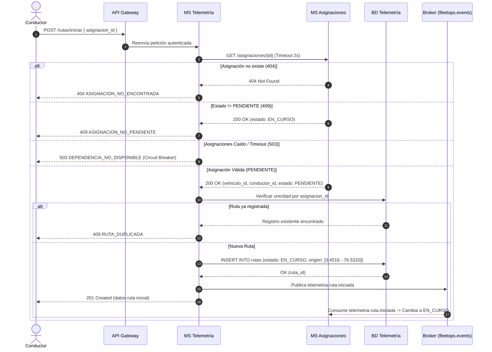

# Telemetría y Rutas — Contexto de Negocio y Dominio

## 1. Visión General del Microservicio

El microservicio **Telemetría y Rutas** (`grupo_06_Telemetria`) forma parte del ecosistema **FleetOps** y es el núcleo del **Proceso 5: Registro de Combustible y Telemetría (Rutas)**.

Su responsabilidad primordial es gestionar el ciclo de vida de los recorridos operativos de la flota de vehículos, registrar los puntos de inicio y fin, simular matemáticamente la telemetría y distancias recorridas (ante la ausencia inicial de hardware GPS físico), y propagar de manera síncrona y asíncrona la información requerida por los demás microservicios (Asignaciones, Combustible, Vehículos, Mantenimiento y Reportes Operativos).

---

## 2. Contexto Actual y Problemática de Negocio

* **Situación inicial:** El control de combustible y recorrido se realizaba históricamente mediante planillas físicas de papel que se consolidaban manualmente con una periodicidad mensual.
* **Problema detectado:** Al no existir una vinculación directa e inmediata entre el consumo de combustible, la asignación de viaje y el recorrido real del vehículo, la administración no podía detectar consumos anómalos ni desvíos de ruta a tiempo.
* **Consecuencias:** Sobrecostos operativos, riesgo de fraude o robo de combustible, desactualización del kilometraje real en los odómetros de los vehículos y retraso en los mantenimientos preventivos.
* **Objetivo de la solución:** Sistematizar el registro y ciclo de vida de las rutas vinculándolas obligatoriamente a una asignación activa, proveyendo trazabilidad geoespacial simulada y entregando información consolidada en tiempo oportuno para auditoría, control de combustible y actualización del odómetro de flota.

---

## 3. Actores del Sistema

| Actor | Tipo | Rol y Responsabilidad |
| :--- | :--- | :--- |
| **Conductor (Operario)** | Humano | Inicia formalmente el recorrido desde su terminal/app móvil y reporta el fin de viaje al completar la entrega. |
| **Sistema (Microservicio Combustible)** | Consumidor interno | Consulta la vigencia de la ruta en curso antes de autorizar el registro de tanqueos en ruta. |
| **Sistema (Microservicio Asignaciones)** | Productor / Consumidor | Valida el estado `PENDIENTE` de la asignación e informa eventos de interrupción imprevista por incidentes. |
| **Sistema (Microservicio Vehículos)** | Consumidor asíncrono | Recibe la distancia final/parcial recorrida para acumularla en el odómetro (`kilometraje_actual`). |
| **Gerencia / Administrador de Flota** | Humano / Reportes | Consulta el historial de rutas, audita distancias y analiza KPIs mediante agregaciones del microservicio de Reportes Operativos. |
| **Ingeniero DevOps / SRE** | Operaciones | Monitorea la salud del microservicio y sus dependencias a través de sondeos de salud (`/health`). |

---

## 4. Mapa de Interacciones en el Ecosistema FleetOps

```mermaid
flowchart TD
    subgraph Frontend
        C[Conductor / Operario]
    end

    subgraph "API Gateway / Seguridad"
        GW[API Gateway - Valida JWT]
    end

    subgraph "MS Telemetría y Rutas (Grupo 06)"
        API_TR[API REST Telemetría]
        SVC_TR[Servicio de Rutas & Simulación Haversine]
        BD_TR[(Base de Datos Propia - Rutas, Outbox, Eventos Procesados)]
        CONS_TR[Consumidor Asíncrono q.telemetria]
    end

    subgraph "Dependencias Síncronas Externas"
        MS_ASIG_REST[MS Asignaciones: GET /asignaciones/id]
        MS_REP[MS Reportes Operativos: GET /rutas]
    end

    subgraph "Broker de Mensajería (RabbitMQ: fleetops.events)"
        TOPIC_EX[Exchange Topic: fleetops.events]
        Q_TELEMETRIA[Cola: q.telemetria]
        Q_DLQ[Cola: q.telemetria.dlq]
    end

    subgraph "Consumidores / Productores de Eventos"
        MS_COMB[MS Combustible]
        MS_VEH[MS Vehículos]
        MS_ASIG_EVT[MS Asignaciones Event Listener]
    end

    %% Flujo Inicio
    C -->|POST /rutas/iniciar| GW
    GW --> API_TR
    API_TR --> SVC_TR
    SVC_TR -->|GET /asignaciones/{id} síncrono con Circuit Breaker| MS_ASIG_REST
    SVC_TR --> BD_TR
    SVC_TR -->|Publica telemetria.ruta.iniciada| TOPIC_EX
    TOPIC_EX --> MS_ASIG_EVT

    %% Flujo Combustible
    MS_COMB -.->|Solicitud de validación de ruta activa| Q_TELEMETRIA
    Q_TELEMETRIA --> CONS_TR
    CONS_TR -->|Consulta local sin llamadas externas| BD_TR
    CONS_TR -.->|Respuesta / Aprobación 200| TOPIC_EX
    TOPIC_EX -.-> MS_COMB

    %% Flujo Fin de Ruta
    C -->|POST /rutas| GW
    GW --> API_TR
    SVC_TR -->|Simulación Haversine & Persistencia FINALIZADA| BD_TR
    SVC_TR -->|Publica telemetria.ruta.finalizada via Outbox| TOPIC_EX
    TOPIC_EX --> MS_VEH
    TOPIC_EX --> MS_ASIG_EVT

    %% Flujo Interrupción
    TOPIC_EX -->|asignaciones.asignacion.interrumpida| Q_TELEMETRIA
    CONS_TR -->|Cierra ruta como INTERRUMPIDA y calcula distancia parcial| BD_TR
    CONS_TR -->|Publica telemetria.ruta.finalizada estado: INTERRUMPIDA| TOPIC_EX

    %% Flujo Consultas
    MS_REP -->|GET /rutas con filtros y paginación| GW
```

---

## 5. Flujos Detallados del Negocio

### 5.1. Flujo 1: Inicio de Ruta (Síncrono + Emisión de Evento)
1. **Acción del Conductor:** El conductor entra en su aplicación y presiona **"Iniciar Ruta"** en una asignación activa.
2. **Petición HTTP:** El frontend envía `POST /rutas/iniciar` con `{ "asignacion_id": "asig-8472" }`.
   * *Importante:* El frontend **no** envía coordenadas GPS; únicamente emite la orden de inicio.
3. **Validación Externa con Asignaciones:** Telemetría realiza una petición HTTP síncrona `GET /asignaciones/{id}`:
   * Si responde `404`: devuelve `404 ASIGNACION_NO_ENCONTRADA`.
   * Si el estado es diferente de `PENDIENTE` (ej. ya en curso, finalizada o cancelada): devuelve `409 ASIGNACION_NO_PENDIENTE`.
   * Si Asignaciones no responde o falla (timeout de 2s): aplica **Circuit Breaker** (5 fallos = circuito abierto por 30s) y responde `503 DEPENDENCIA_NO_DISPONIBLE`.
4. **Validación de Unicidad:** Verifica en su base de datos local que no exista ya una ruta asociada a esa asignación (regla de negocio: una asignación solo tiene una ruta en el MVP). Si ya existe, responde `409 RUTA_DUPLICADA`.
5. **Persistencia Local:** Guarda la ruta con estado `EN_CURSO`, `hora_inicio` en UTC y coordenada de origen por defecto fijada en el Centro de Operaciones de FleetCorp:
   * **Latitud:** `3.4516`
   * **Longitud:** `-76.5320`
   * Almacena además `vehiculo_id` y `conductor_id` obtenidos de la respuesta de Asignaciones.
6. **Publicación de Evento:** Publica en RabbitMQ el evento `RutaIniciadaEvent` (`telemetria.ruta.iniciada`) en el exchange topic `fleetops.events`.
7. **Reacción Externa:** El microservicio de Asignaciones consume el evento y actualiza la asignación a `EN_CURSO`.



---

### 5.2. Flujo 2: Consulta y Verificación de Ruta en Curso para Combustible
1. Mientras un viaje está activo, el conductor puede registrar tanqueos en el microservicio de Combustible (`POST /combustible`).
2. Combustible necesita verificar que la asignación tenga una ruta activa `EN_CURSO` y obtener el `ruta_id`.
3. La consulta se atiende mediante mensajería / evento de solicitud:
   * Telemetría consulta **exclusivamente su base de datos local** (cero llamadas salientes HTTP).
   * Si existe ruta `EN_CURSO`: emite respuesta con código lógico `200` y el `ruta_id`.
   * Si no existe ruta (`404`) o ya está `FINALIZADA` / `INTERRUMPIDA` (`409`): responde con código de rechazo para que Combustible rechace el registro del tanqueo.
   * Cuenta con índice sobre `(asignacion_id, estado)` para garantizar latencias **P95 < 200 ms**.
   * Aplica tabla de `eventos_procesados` para deduplicación idempotente.

---

### 5.3. Flujo 3: Fin de Ruta y Simulación Geoespacial
1. **Acción del Conductor:** El conductor llega a su destino y presiona **"Terminar Ruta"**.
2. **Petición HTTP:** `POST /rutas` con `{ "asignacion_id": "asig-8472" }`.
3. **Validación:**
   * Busca la ruta activa asociada en la base de datos local.
   * Si no existe: `404 RUTA_NO_ENCONTRADA`.
   * Si no está en estado `EN_CURSO` (ej. ya finalizada o interrumpida): `409 ESTADO_RUTA_INVALIDO`.
4. **Simulación Geoespacial (Algoritmo Haversine):**
   * Captura la `hora_fin` (timestamp actual en UTC).
   * Recupera la `coordenada_origen` registrada en el inicio (`lat: 3.4516, lon: -76.5320`).
   * Genera una `coordenada_destino` aplicando un desplazamiento aleatorio dentro de un radio de **5 km a 25 km** respecto al origen.
   * Calcula la distancia final en kilómetros mediante la fórmula de Haversine ($R = 6371.0\text{ km}$).
   * Redondea `distancia_recorrida_km` a 2 decimales.
   * Si el tiempo transcurrido entre inicio y fin es inferior a 1 minuto, asigna una distancia mínima de salvaguarda de **0.50 km**.
5. **Persistencia Atómica & Outbox:**
   * En una misma transacción de base de datos, actualiza la ruta a `FINALIZADA` con `hora_fin`, `coordenada_destino` y `distancia_recorrida_km`, e inserta el evento en la tabla `outbox_eventos`.
   * Responde `200 OK` al conductor con el resumen completo del viaje.
6. **Propagación Asíncrona (`RutaFinalizadaEvent`):**
   * El evento con routing key `telemetria.ruta.finalizada` y `estado_ruta: "FINALIZADA"` llega a RabbitMQ:
     * **MS Vehículos:** Suma `distancia_recorrida_km` a su `kilometraje_actual` (odómetro).
     * **MS Asignaciones:** Cambia la asignación de `EN_CURSO` a `FINALIZADA`.

---

### 5.4. Flujo 4: Interrupción Imprevista de Ruta por Incidente
1. Cuando ocurre un accidente, varada o siniestro en vía, el flujo de gestión de incidentes interrumpe la asignación.
2. El MS de Asignaciones emite el evento `asignaciones.asignacion.interrumpida` al exchange topic `fleetops.events`.
3. Telemetría consume este evento desde la cola `q.telemetria`.
4. **Idempotencia:** Verifica el `evento_id` contra la tabla `eventos_procesados`. Si ya se procesó, confirma con ACK sin duplicar lógica.
5. **Tolerant Reader:** Deserializa `asignacion_id` e ignora atributos extraños (como `incidente_id` o `reasignacion_resultado`).
6. **Búsqueda y Cierre Parcial:**
   * Si hay una ruta en estado `EN_CURSO` para esa asignación:
     * Fija `hora_fin` con el timestamp del incidente.
     * Calcula una coordenada intermedia y la distancia parcial recorrida hasta el momento usando la misma fórmula Haversine.
     * Actualiza el estado de la ruta a `INTERRUMPIDA`.
     * **Regla estricta:** La ruta jamás se borra; se preserva su trazabilidad completa.
7. **Emisión de Odómetro Parcial:**
   * Publica `telemetria.ruta.finalizada` con `estado_ruta: "INTERRUMPIDA"` y la distancia parcial calculada.
   * **MS Vehículos:** Suma la distancia parcial a su odómetro para no perder el kilometraje recorrido antes del siniestro.
   * **MS Asignaciones:** Recibe el evento pero, al encontrarse ya en `INTERRUMPIDA_POR_INCIDENTE`, lo descarta según sus reglas de catálogo de estados.

---

### 5.5. Flujo 5: Auditoría Gerencial y Soporte a Reportes Operativos
1. **Petición:** `GET /rutas` con filtros (`asignacion_id`, `vehiculo_id`, `estado`, `fecha_desde`, `fecha_hasta`, `page`, `size`).
2. **Requisitos de rendimiento:** El MS Reportes Operativos consulta este endpoint síncronamente durante su proceso de agregación paralela de KPIs (`distancia_total_recorrida_km`, `rutas_en_curso`).
3. El endpoint debe responder en **menos de 1.0 segundo** respaldado por índices compuestos sobre `(estado, hora_inicio)`.
4. Retorna paginación normalizada con `contenido`, `page`, `size` y `total`.
