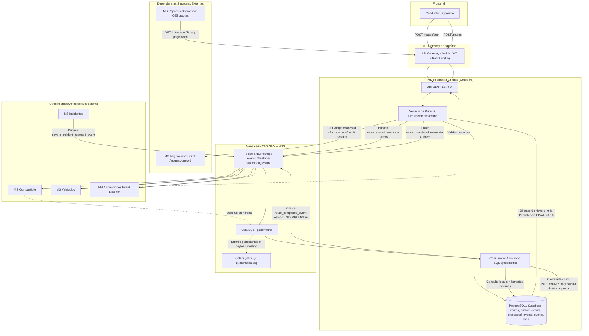
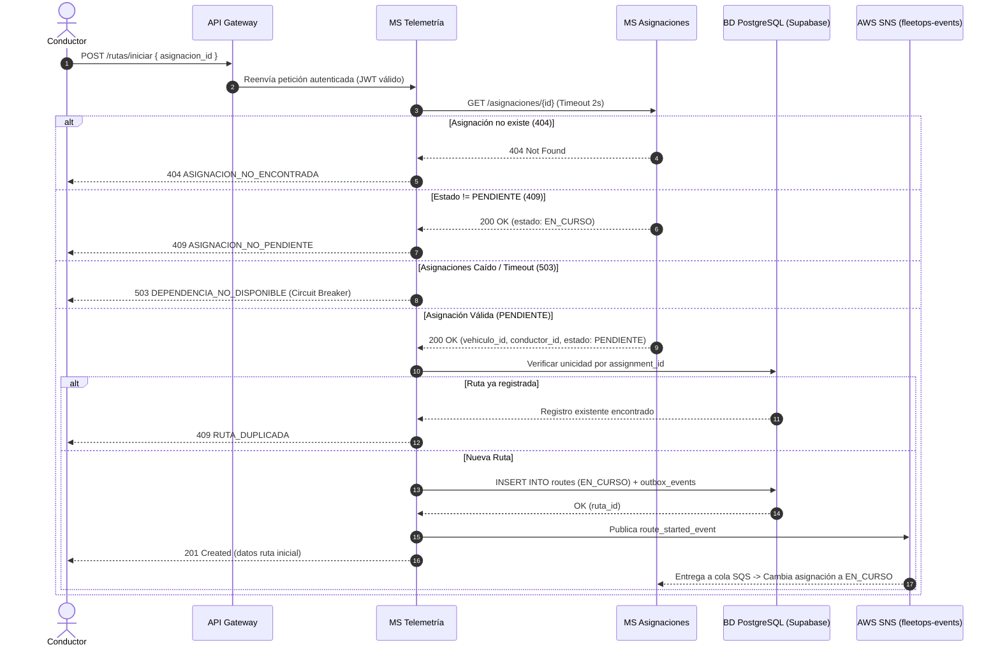

# Telemetría y Rutas — Contexto de Negocio y Dominio

## 1. Visión General del Proyecto y del Microservicio

**FleetOps** es una plataforma empresarial backend distribuida basada en arquitectura de microservicios independientes, diseñada y desarrollada para modernizar la gestión integral de flotas de **FleetCorp S.A.** en el marco del curso *750027C – Desarrollo de Software III* (Universidad del Valle, Prof. Manuel Alejandro Pastrana Pardo, PhD.).

El microservicio **Telemetría y Rutas** (`grupo_06_Telemetria`) forma parte del ecosistema **FleetOps** y constituye el núcleo del **Proceso 5: Registro de Combustible y Telemetría (Rutas)**, además de participar activamente en el **Proceso 2B: Reporte de Incidente Grave** y el **Proceso 6: Generación de Reportes y KPIs Operativos**.

Su responsabilidad primordial es gestionar el ciclo de vida de los recorridos operativos de la flota (`EN_CURSO`, `FINALIZADA`, `INTERRUMPIDA`), registrar los puntos de inicio y fin, simular matemáticamente la telemetría y distancias recorridas (ante la ausencia inicial de hardware GPS físico, mediante la fórmula de Haversine), y propagar de manera síncrona (REST) y asíncrona (eventos sobre **AWS SNS/SQS**) la información requerida por los demás microservicios (Asignaciones, Combustible, Vehículos, Mantenimiento, Incidentes y Reportes Operativos).

---

## 2. Contexto de la Empresa (FleetCorp S.A.)

**FleetCorp S.A.** es una empresa mediana dedicada a la gestión y administración de flotas de vehículos corporativos utilizados para:
* Operaciones logísticas livianas.
* Soporte técnico en campo.
* Transporte interno de personal.

La compañía opera en varias ciudades del país y administra una flota superior a **250 vehículos**, compuesta por automóviles, camionetas y vehículos especializados. Durante los últimos años, FleetCorp ha experimentado un crecimiento sostenido en su operación, incrementando tanto el tamaño de su flota y el número de sedes operativas como la cantidad de empleados que requieren asignaciones temporales para cumplir sus funciones. Sin embargo, este crecimiento no estuvo acompañado de una evolución equivalente en sus procesos internos de control, trazabilidad y seguimiento.

---

## 3. Problemática y Operación Actual (As-Is)

El levantamiento de información realizado al interior de FleetCorp evidenció que la operación de la flota se sostiene sobre canales informales (llamadas telefónicas, correos electrónicos) y herramientas de propósito general aisladas (hojas de cálculo compartidas, carpetas físicas y planillas en papel), generando fallas estructurales en todo el ciclo de vida operativo:

1. **Ausencia de trazabilidad centralizada:** No existe una plataforma única que permita visualizar en tiempo real el estado real de los vehículos ni su historial completo, provocando inconsistencias entre la información reportada por distintas áreas.
2. **Asignación manual de vehículos y conductores:** Cuando un empleado solicita un vehículo por correo o contacto directo, el administrador verifica manualmente la disponibilidad en una hoja de cálculo compartida. Paralelamente, la información de conductores autorizados y la vigencia de sus licencias reside en un archivo separado, desconectado de cualquier validación automática al momento de asignar.
3. **Incidentes sin bloqueo automático:** Ante accidentes o fallas mecánicas, el conductor reporta telefónicamente al área administrativa, que coordina por correo con mantenimiento. Al no existir un registro centralizado ni bloqueo automático, un vehículo averiado puede seguir siendo asignado pese a no estar en condiciones de operar.
4. **Mantenimientos preventivos y correctivos desarticulados:** Los mantenimientos preventivos dependen de recordatorios manuales sin monitoreo automático de kilometraje ni alertas por umbrales, ocasionando fallas mecánicas evitables y mayores costos. Los correctivos se coordinan por correo sin trazabilidad formal respecto al incidente que los originó.
5. **Gestión documental reactiva:** La vigencia de licencias de conducción, SOAT, revisión tecnomecánica y pólizas se revisa manualmente, por lo general cuando el documento ya venció, generando sanciones económicas y vehículos operando sin cobertura vigente.
6. **Control deficiente de combustible y rutas:** Los conductores reportan el consumo mediante planillas físicas consolidadas una sola vez al mes, sin vinculación directa con la asignación o el recorrido que lo generó. Esto impide detectar oportunamente sobrecostos, desvíos de ruta, fraude o patrones de consumo anómalos.
7. **Ausencia de alertas automáticas y métricas confiables:** Ninguna área cuenta con notificaciones tempranas de vencimientos, mantenimientos próximos o incidentes sin resolver. Los reportes operativos se construyen manualmente a partir de fuentes dispersas e inconsistentes, impidiendo responder preguntas gerenciales críticas como:
   * ¿Cuál es el porcentaje real de disponibilidad de la flota?
   * ¿Cuántos vehículos están en mantenimiento preventivo frente a correctivo?
   * ¿Cuál es el tiempo promedio de reparación?
   * ¿Qué vehículos tienen documentación próxima a vencer?

### Objetivo y Alcance de la Solución
* **Objetivo:** Diseñar, desarrollar y desplegar una plataforma backend distribuida basada en microservicios independientes con bases de datos propias (*Database-per-Service*), aplicando arquitectura REST, comunicación orientada a eventos (**AWS SNS/SQS**) y prácticas modernas de DevOps (Pull Requests con revisión obligatoria, pipelines CI/CD en GitHub Actions, análisis estático y Quality Gate con SonarCloud, despliegue en contenedores Docker sobre AWS EC2 y monitoreo activo con Prometheus y Grafana).
* **Alcance específico:** El proyecto se enfoca exclusivamente en el backend y el proceso de ingeniería de software (sin requerir hardware GPS real ni comunicación en tiempo real; las coordenadas y recorridos se registran de forma manual o simulada).

---

## 4. Microservicios del Ecosistema FleetOps y sus Relaciones

El sistema está compuesto por **diez (10) microservicios independientes**, organizados en células de trabajo. Por lineamiento arquitectónico, cada microservicio debe consumir al menos un servicio externo y ser consumido por al menos otro servicio, con excepción de **Reportes Operativos**, que actúa como servicio terminal de agregación (*Scatter-Gather*).

| Equipo / Microservicio | Responsabilidad Principal | Endpoints Mínimos | Servicios que Consume |
| :--- | :--- | :--- | :--- |
| **Equipo 1 – Vehículos** | Gestión del inventario de vehículos, estado operativo y odómetro (`kilometraje_actual`). | `POST /vehiculos` `GET /vehiculos/{id}` | Documentación y Seguros (y eventos de Telemetría e Incidentes) |
| **Equipo 2 – Conductores** | Gestión de conductores autorizados, estado de habilitación y licencias. | `POST /conductores` `GET /conductores/{id}` | Documentación y Seguros (y eventos de Incidentes) |
| **Equipo 3 – Documentación y Seguros** | Control de vigencia de SOAT, revisión tecnomecánica, pólizas y licencias. | `POST /documentos` `GET /documentos/{id}` | Vehículos |
| **Equipo 4 – Asignaciones** | Gestión del ciclo de vida de la asignación vehículo-conductor. | `POST /asignaciones` `GET /asignaciones/{id}` | Vehículos, Conductores (y eventos de Telemetría e Incidentes) |
| **Equipo 5 – Incidentes** | Registro de incidentes leves y graves en ruta y activación de protocolos. | `POST /incidentes` `GET /incidentes/{id}` | Asignaciones, Vehículos |
| **Equipo 6 – Mantenimiento** | Programación preventiva (scheduler interno) y órdenes correctivas derivadas de incidentes. | `POST /mantenimientos` `GET /mantenimientos/{id}` | Incidentes, Vehículos |
| **Equipo 7 – Combustible** | Registro de tanqueos, cálculo de rendimiento (`km/galón`) y detección de anomalías. | `POST /combustible` `GET /combustible/{id}` | Asignaciones, Telemetría |
| **Equipo 8 – Telemetría y Rutas** *(Grupo 06)* | Gestión del ciclo de vida de recorridos por asignación y simulación de telemetría/distancias. | `POST /rutas` `POST /rutas/iniciar` `GET /rutas/{id}` | Asignaciones (y consume eventos de Incidentes / Combustible) |
| **Equipo 9 – Notificaciones** | Despacho de alertas tempranas de mantenimiento, vencimientos documentales e incidentes. | `GET /notificaciones/estado` `POST /notificaciones` | Mantenimiento, Incidentes, Documentación y Seguros |
| **Equipo 10 – Reportes Operativos** | Orquestador terminal de consultas y cálculo de KPIs operativos gerenciales. | `GET /reportes/disponibilidad` | Vehículos, Asignaciones, Incidentes, Mantenimiento, Combustible, Telemetría, Notificaciones |

---

## 5. Actores del Sistema (Perspectiva Telemetría y Rutas)

| Actor | Tipo | Rol y Responsabilidad |
| :--- | :--- | :--- |
| **Conductor (Operario)** | Humano | Inicia formalmente el recorrido desde la aplicación cliente (`POST /rutas/iniciar`), consulta su ruta asignada y reporta el fin de viaje (`POST /rutas`). |
| **MS Asignaciones** | Sistema (Productor / Consumidor) | Valida el estado `PENDIENTE` de la asignación al iniciar ruta; escucha `route_started_event` y `route_completed_event`; emite eventos de interrupción ante incidentes graves. |
| **MS Combustible** | Sistema (Consumidor) | Verifica que exista una ruta activa `EN_CURSO` antes de autorizar el registro de tanqueos en estación (`POST /combustible`). |
| **MS Vehículos** | Sistema (Consumidor asíncrono) | Recibe `route_completed_event` para acumular `distancia_recorrida_km` en el odómetro oficial (`kilometraje_actual`) de la flota. |
| **MS Incidentes** | Sistema (Productor asíncrono) | Emite `severe_incident_reported_event` cuando ocurre un siniestro grave en ruta, disparando la interrupción automática del recorrido activo. |
| **MS Reportes Operativos** | Sistema (Consumidor síncrono) | Consulta `GET /rutas` durante su agregación paralela (*Scatter-Gather*) para calcular KPIs de disponibilidad y kilometraje total. |
| **Gerencia / Administrador de Flota** | Humano | Audita el historial de rutas y analiza métricas operativas consolidadas en el dashboard de Reportes Operativos. |
| **Ingeniero DevOps / SRE** | Operaciones | Monitorea la salud del microservicio, base de datos y conectividad con AWS SNS/SQS mediante `GET /health`, Prometheus y Grafana. |

---

## 6. Mapa de Interacciones en el Ecosistema FleetOps

---

## 7. Flujos Detallados del Negocio

### 7.1. Flujo 1: Inicio de Ruta (Proceso 5 — Síncrono + Emisión de Evento)
1. **Acción del Conductor:** El conductor entra en su aplicación y presiona **"Iniciar Ruta"** en una asignación activa.
2. **Petición HTTP:** El frontend envía `POST /rutas/iniciar` con `{ "asignacion_id": "<uuid>" }`.
   * *Importante:* El frontend **no** envía coordenadas GPS; únicamente emite la orden de inicio.
3. **Validación Externa con Asignaciones:** Telemetría realiza una petición HTTP síncrona `GET /asignaciones/{id}`:
   * Si responde `404`: devuelve `404 ASIGNACION_NO_ENCONTRADA`.
   * Si el estado es diferente de `PENDIENTE` (ej. ya en curso, finalizada o cancelada): devuelve `409 ASIGNACION_NO_PENDIENTE`.
   * Si Asignaciones no responde o falla (timeout de `2 s`): aplica **Circuit Breaker** (5 fallos consecutivos = circuito abierto por 30 s) y responde `503 DEPENDENCIA_NO_DISPONIBLE`.
4. **Validación de Unicidad:** Verifica en su base de datos local que no exista ya una ruta asociada a esa asignación (una asignación solo tiene una ruta en el MVP). Si ya existe, responde `409 RUTA_DUPLICADA`.
5. **Persistencia Local:** Guarda la ruta en `routes` con estado `EN_CURSO`, `started_at` en UTC y coordenada de origen por defecto fijada en el Centro de Operaciones de FleetCorp:
   * **Latitud:** `3.4516`
   * **Longitud:** `-76.5320`
   * Almacena además `vehicle_id` y `driver_id` obtenidos de Asignaciones.
6. **Publicación de Evento (`route_started_event`):** Registra el evento en `outbox_events` y lo publica hacia el tópico **AWS SNS** (`fleetops-events` / `fleetops-telemetria_events`).
7. **Reacción Externa:** El MS Asignaciones consume el evento y actualiza la asignación a `EN_CURSO`; Combustible y Reportes Operativos pueden mantener estado local mediante *Event-Carried State Transfer*.

---

### 7.2. Flujo 2: Consulta y Verificación de Ruta en Curso para Combustible (Proceso 5)
1. Mientras un viaje está activo, el conductor registra tanqueos en el microservicio de Combustible (`POST /combustible`).
2. Combustible necesita verificar que la asignación tenga una ruta activa `EN_CURSO` y obtener el `ruta_id`.
3. La validación se resuelve consultando **exclusivamente la base de datos local de Telemetría** (cero llamadas HTTP salientes hacia otros servicios):
   * Si existe ruta `EN_CURSO`: confirma validez con código lógico `200` y retorna el `ruta_id`.
   * Si no existe ruta (`404`) o ya está `FINALIZADA` / `INTERRUMPIDA` (`409`): responde con rechazo para que Combustible deniegue el tanqueo.
   * Respaldado por índice compuesto sobre `(assignment_id, status)` para garantizar latencias **P95 < 200 ms** y deduplicación en `processed_events`.

---

### 7.3. Flujo 3: Fin de Ruta y Simulación Geoespacial (Proceso 5)
1. **Acción del Conductor:** El conductor llega a su destino y presiona **"Terminar Ruta"**.
2. **Petición HTTP:** `POST /rutas` con `asignacion_id` (y opcionalmente coordenadas simuladas de destino si son provistas, o generadas por el motor de simulación).
3. **Validación:**
   * Busca la ruta activa asociada en la base de datos local.
   * Si no existe: `404 RUTA_NO_ENCONTRADA`.
   * Si no está en estado `EN_CURSO` (ej. ya finalizada o interrumpida): `409 ESTADO_RUTA_INVALIDO`.
4. **Simulación Geoespacial (Algoritmo Haversine):**
   * Captura `ended_at` (timestamp actual en UTC).
   * Recupera la coordenada de origen registrada al inicio (`lat: 3.4516, lon: -76.5320`).
   * Calcula o genera la coordenada de destino (desplazamiento aleatorio dentro de un radio de **5 km a 25 km** respecto al origen cuando no hay hardware GPS).
   * Calcula la distancia final en kilómetros mediante la fórmula de Haversine ($R = 6371.0\text{ km}$), redondeada a 2 decimales, aplicando una distancia mínima de salvaguarda de **0.50 km** si la duración es inferior a 1 minuto.
5. **Persistencia Atómica & Transactional Outbox:**
   * En una misma transacción ACID, actualiza la ruta a `FINALIZADA` con `ended_at`, coordenadas de destino y `distance_traveled_km`, e inserta `route_completed_event` en `outbox_events`.
   * Responde `200 OK` al conductor con el resumen completo del viaje.
6. **Propagación Asíncrona (`route_completed_event`):**
   * El worker de Outbox publica el evento en **AWS SNS** (`fleetops-events` / `fleetops-telemetria_events`):
     * **MS Vehículos:** Suma `distancia_recorrida_km` a su `kilometraje_actual` (odómetro oficial).
     * **MS Asignaciones:** Cambia la asignación de `EN_CURSO` a `FINALIZADA`.

---

### 7.4. Flujo 4: Interrupción Imprevista de Ruta por Incidente Grave (Proceso 2B)
1. Cuando ocurre un siniestro grave en ruta (colisión, falla mecánica crítica, lesión), el conductor reporta el incidente en MS Incidentes (`POST /incidentes`).
2. MS Incidentes publica el evento `severe_incident_reported_event` hacia el tópico **AWS SNS** (`fleetops-events`).
3. De forma paralela en el ecosistema:
   * **MS Asignaciones** cambia la asignación a `INTERRUMPIDA_POR_INCIDENTE`.
   * **MS Mantenimiento** genera una orden correctiva urgente.
   * **MS Vehículos** bloquea la unidad (`BLOQUEADO`) hasta liberación de taller.
   * **MS Conductores** inhabilita preventivamente al conductor (`INHABILITADO_MEDICO_INCIDENTE`).
   * **MS Notificaciones** despacha alertas urgentes a taller, grúa, ambulancia y administración.
4. **MS Telemetría y Rutas** consume el evento desde la cola **AWS SQS** `q.telemetria`:
   * **Idempotencia:** Verifica `evento_id` contra `processed_events`. Si ya se procesó, confirma el mensaje en SQS sin duplicar lógica.
   * **Tolerant Reader:** Deserializa `asignacion_id` e ignora campos adicionales (como `incidente_id` o `reasignacion_resultado`). Mensajes malformados se envían a `q.telemetria.dlq`.
   * **Cierre Parcial:** Si existe una ruta `EN_CURSO`, fija `ended_at`, calcula distancia parcial proporcional con Haversine, actualiza el estado a `INTERRUMPIDA` (sin borrar jamás el registro) y publica `route_completed_event` con estado `INTERRUMPIDA` vía Outbox para que Vehículos sume el kilometraje parcial al odómetro.

---

### 7.5. Flujo 5: Auditoría Gerencial y Soporte a Reportes Operativos (Proceso 6)
1. **Orquestación Scatter-Gather:** Cuando Gerencia solicita el dashboard (`GET /reportes/disponibilidad`), el MS Reportes Operativos dispara consultas HTTP paralelas hacia Vehículos, Asignaciones, Incidentes, Mantenimiento, Combustible, Notificaciones y **Telemetría y Rutas** (`GET /rutas`).
2. **Petición a Telemetría:** `GET /rutas` con filtros (`asignacion_id`, `vehiculo_id`, `estado`, `fecha_desde`, `fecha_hasta`, `page`, `size`).
3. **Requisitos de rendimiento:** El endpoint responde en **menos de 1.0 segundo**, respaldado por índices compuestos sobre `(status, started_at)`, retornando paginación normalizada (`contenido`, `page`, `size`, `total`).
