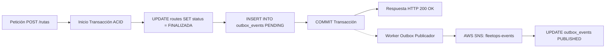
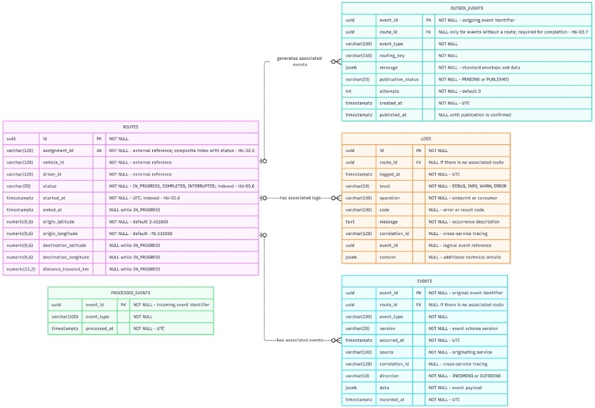
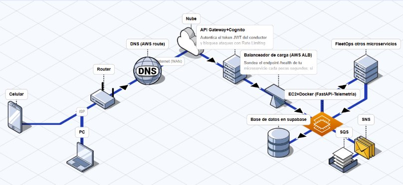
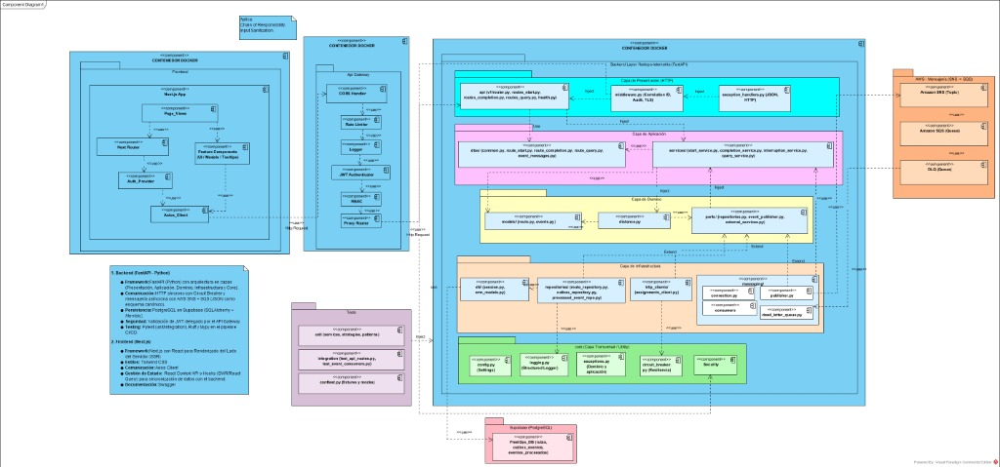
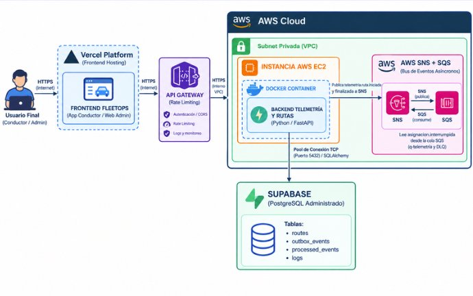

# Documento de Arquitectura de Software (DAS) — FleetOps: Telemetría y Rutas

**Organización:** Yummy Inc / Grupo 06 (`grupo_06_Telemetria`)  
**Fecha de versión:** 29 de octubre de 2026  
**Norma de referencia:** ISO/IEC 25010:2023  

### Control de Cambios y Autoría

| Rol | Integrantes / Responsable | Fecha |
| :--- | :--- | :--- |
| **Autores** | Sara Julissa Hernández (2610102), Ana Sofía Cantillo Bolaños (2610112), Juan David Rincón (2342032), Samuel Arenas Valencia (2341928), Miguel Ángel Castillo (2341975), Juan Esteban Pereira (2569259) | 04/03/2026 |
| **Revisado por** | Samuel Arenas Valencia | 29/10/2026 |
| **Aprobado por** | Samuel Arenas Valencia | 29/10/2026 |

---

## 1. Introducción

### 1.1. Visión General
El presente Documento de Arquitectura de Software (DAS) describe la arquitectura del microservicio **Telemetría y Rutas** (`grupo_06_Telemetria`), componente de la plataforma **FleetOps** para la gestión logística de la flota de **FleetCorp S.A.** El servicio es el núcleo del **Proceso 5: Registro de Combustible y Telemetría (Rutas)**, gestionando el ciclo de vida de los recorridos operativos (inicio, finalización e interrupción), simulando la telemetría y la distancia recorrida mientras no existan dispositivos GPS físicos, y propagando esa información a los demás microservicios del ecosistema.

El documento captura las decisiones arquitectónicas críticas y la selección del stack tecnológico: **Python 3.12**, **FastAPI**, **SQLAlchemy**, **PostgreSQL** (administrado en **Supabase**), **AWS SNS/SQS** y **Docker**, teniendo en cuenta los principios de diseño estructural que garantizan el cumplimiento de los requerimientos funcionales y de los atributos de calidad definidos bajo la norma **ISO/IEC 25010**.

---

## 2. Propósito

### 2.1. Rol del Documento
El propósito fundamental de este DAS es servir como la **única fuente de verdad** y guía principal para el diseño, la construcción, las pruebas y el despliegue del microservicio Telemetría y Rutas. Su función es documentar y justificar técnicamente el porqué de cada decisión (por ejemplo, *Clean Architecture*, *Transactional Outbox*, *Circuit Breaker*, *Idempotent Consumer* o *Database-per-Service*), asegurando que el equipo comparta una visión unificada sobre cómo debe estructurarse, desarrollarse y desplegarse el sistema.

---

## 3. Alcance

Este documento abarca la definición de la arquitectura tanto a nivel de código (**atributos observables**) como a nivel de infraestructura (**atributos no observables**). Aplica directamente al equipo de desarrollo del grupo 06 e incluye las pautas de integración con los demás servicios de FleetOps: **Asignaciones**, **Combustible**, **Vehículos**, **Incidentes**, **Reportes Operativos** y el **API Gateway**.

* **Decisiones arquitecturales:** Definición del stack tecnológico (Python 3.12 con FastAPI), la estrategia de API REST para las operaciones síncronas y la arquitectura orientada a eventos (**AWS SNS/SQS**) para la propagación asíncrona.
* **Módulos y funciones:** Delimitación de responsabilidades del servicio según las historias de usuario **HU-01 a HU-06** (iniciar ruta, consultar ruta en curso para combustible, finalizar ruta, procesar interrupción por incidente grave, consultar historial/detalle de rutas y exponer el estado de salud).
* **Alcance del documento:** El grupo 06 es responsable únicamente de Telemetría y Rutas, así como de su correspondiente base de datos.
* **Atributos de calidad:**
  * *Observables:* Decisiones que impactan directamente el código fuente (validaciones con DTOs Pydantic, manejadores de excepciones, Circuit Breaker, idempotencia).
  * *No observables:* Decisiones que recaen sobre la infraestructura y configuración (Docker, pipeline CI/CD en GitHub Actions, SonarCloud, API Gateway, balanceo ALB y monitoreo Prometheus/Grafana).
* **Patrones y técnicas de diseño:** *Clean Architecture*, *Transactional Outbox*, *Circuit Breaker*, *Idempotent Consumer*, *Tolerant Reader*, *Strategy*, *Repository*, *DTO* y *Database-per-Service*.
* **Representación de la solución:** Uso de vistas UML basadas en el modelo 4+1 de Kruchten (vistas lógica, física, de componentes y de despliegue).
* **Fuera de alcance:** La aplicación cliente (frontend Next.js), la implementación interna del API Gateway y validación JWT en Cognito, la implementación de los microservicios vecinos y el hardware GPS real (sustituido por simulación geoespacial Haversine).

---

## 4. Definiciones, Siglas y Abreviaturas

* **DAS:** Documento de Arquitectura de Software.
* **FleetOps:** Plataforma de microservicios para la gestión de la flota de FleetCorp, a la que pertenece este microservicio.
* **MS:** Microservicio.
* **API REST:** Interfaz de programación sobre HTTP/HTTPS basada en recursos, usada para las operaciones síncronas del servicio.
* **API Gateway:** Punto de entrada único al ecosistema. Autentica las peticiones (JWT), aplica límites de tasa (*Rate Limiting*) y enruta hacia los microservicios.
* **JWT (JSON Web Token):** Estándar para la transmisión segura de información de autenticación.
* **ORM (Object-Relational Mapping):** Técnica para convertir datos entre el modelo de objetos y el modelo relacional (en este proyecto, **SQLAlchemy**).
* **ACID:** Propiedades de las transacciones de base de datos: Atomicidad, Consistencia, Aislamiento y Durabilidad.
* **AWS SNS/SQS:** Servicios de mensajería administrados en AWS (*Simple Notification Service* y *Simple Queue Service*) que soportan la comunicación asíncrona entre microservicios mediante el tópico `fleetops-events` (`fleetops-telemetria_events`) y colas SQS.
* **DLQ (Dead Letter Queue):** Cola donde se almacenan los mensajes que no pueden procesarse tras los reintentos o por formato inválido (`q.telemetria.dlq` en AWS SQS).
* **Circuit Breaker:** Patrón que corta temporalmente las llamadas a una dependencia que falla repetidamente para evitar fallos en cascada.
* **Transactional Outbox:** Patrón que guarda el evento a publicar en la misma transacción de base de datos que el cambio de estado, para publicarlo luego hacia AWS SNS sin pérdidas.
* **Tolerant Reader:** Táctica de serialización que extrae solo los campos necesarios e ignora campos adicionales de un mensaje.
* **Idempotent Consumer:** Técnica por la que un mensaje repetido se procesa una sola vez usando un identificador único (`evento_id`).
* **Clean Architecture:** Estilo arquitectónico en capas donde las dependencias apuntan hacia el dominio, aislando el negocio de los detalles de infraestructura.
* **Haversine:** Fórmula que calcula la distancia entre dos coordenadas geográficas sobre una esfera; base de la simulación de recorridos.
* **HU:** Historia de usuario.
* **CI/CD:** Integración y Entrega Continua (pipeline automatizado en GitHub Actions que compila, prueba, valida Quality Gate en SonarCloud y publica la imagen).
* **ISO/IEC 25010:** Norma de calidad del producto de software que define los atributos de calidad evaluados en este DAS.

---

## 5. Referencias

| Documento | Versión | Fecha de la versión |
| :--- | :--- | :--- |
| Product Backlog Refinado (`02_product_backlog_historias_usuario.md`) | 1.1 | 09/03/2026 |
| Norma ISO/IEC 25010:2023 | ISO/IEC 25010:2023 | 11/05/2026 |
| Documentación de Casos de Estudio FleetOps (Contexto y Procesos) | 1.0 | 2026 |

---

## 6. Vista Global

La arquitectura está organizada desde su concepción más abstracta hasta su implementación física, estructurada en capas principales:

* **Capa de presentación:** Expone la API REST (**FastAPI**), valida las entradas con DTOs (**Pydantic**) y traduce las excepciones a respuestas HTTP estandarizadas.
* **Capa de aplicación y Dominio (Lógica de negocio):** Orquesta los casos de uso (iniciar, finalizar, interrumpir y consultar rutas), contiene las reglas de negocio y la simulación geoespacial, definiendo los puertos (interfaces) hacia el exterior.
* **Capa de infraestructura (acceso a datos y mensajería):** Implementa los puertos con **SQLAlchemy** sobre **PostgreSQL (Supabase)**, el cliente HTTP (`httpx`) hacia Asignaciones con Circuit Breaker, y el publicador y consumidores de **AWS SNS/SQS**.

---

## 7. Macro Arquitectura

El microservicio Telemetría y Rutas se diseña bajo un enfoque de arquitectura de microservicios orientada a eventos. Se comunica de forma síncrona (REST sobre HTTP/HTTPS) con el API Gateway, MS Asignaciones y MS Reportes Operativos, y de forma asíncrona (**AWS SNS/SQS**) con Asignaciones, Combustible, Vehículos e Incidentes. Internamente aplica **Clean Architecture** en capas, garantizando alta cohesión y bajo acoplamiento: el dominio no depende de FastAPI, SQLAlchemy ni de AWS SDK (`boto3`); esos detalles se conectan mediante puertos e inyección de dependencias.

### Capas de la solución
* **Capa de Presentación (`presentation`):** API REST construida con FastAPI. Contiene los routers (`routes_start.py`, `routes_completion.py`, `routes_query.py`, `health.py`), middleware (`Correlation ID`, `Audit`, `TLS`) y manejadores globales de excepciones (`exception_handlers.py`). Los DTOs Pydantic filtran datos erróneos antes de llegar a la lógica de negocio.
* **Capa de Aplicación (`application`):** Servicios de aplicación (`start_service.py`, `completion_service.py`, `interruption_service.py`, `query_service.py`) y DTOs de aplicación que implementan los casos de uso y coordinan repositorios, cliente de Asignaciones y publicación de eventos dentro de una unidad de trabajo transaccional.
* **Capa de Dominio (`domain`):** Modelos (`route.py`, `events.py`), estados (`EN_CURSO`, `FINALIZADA`, `INTERRUMPIDA`), cálculo de distancia (`distance.py`) y puertos/interfaces (`repositories.py`, `event_publisher.py`, `external_services.py`). Aquí residen las reglas estrictas: una asignación tiene una sola ruta, las rutas nunca se eliminan y la distancia mínima de salvaguarda es `0.50 km`.
* **Capa de Infraestructura (`infrastructure`):** Implementaciones concretas de los puertos: modelos ORM y sesión (`db/`), repositorios SQLAlchemy sobre PostgreSQL (`route_repository.py`, `outbox_repository.py`, `processed_event_repo.py`), cliente HTTP hacia Asignaciones (`assignments_client.py`) y mensajería AWS SNS/SQS (`connection.py`, `publisher.py`, `consumers.py`, `dead_letter_queue.py`).
* **Núcleo Transversal (`core`):** Configuración externalizada mediante variables de entorno (`config.py`), logging estructurado (`logging.py`), excepciones propias (`exceptions.py`), seguridad (`security.py`) y la implementación del Circuit Breaker (`circuit_breaker.py`).

### 7.1. Comunicación entre capas y el exterior
La dependencia entre capas es unidireccional: `presentation -> application -> domain`, mientras que `infrastructure` implementa los puertos definidos en `domain`. Solo los repositorios de Infraestructura están autorizados a comunicarse con la base de datos a través del ORM.

Hacia el exterior, el servicio utiliza dos canales:
* **Comunicación síncrona (REST):**
  * El conductor envía las órdenes de inicio, fin y consulta de ruta a través del API Gateway, que valida el JWT (Cognito) antes de reenviar la petición.
  * Telemetría consulta `GET /asignaciones/{id}` en el MS de Asignaciones con un timeout de `2.0 s` y un **Circuit Breaker** (5 fallos consecutivos abren el circuito durante `30 s`).
  * El MS Reportes Operativos consulta `GET /rutas` con filtros y paginación.
* **Comunicación asíncrona (AWS SNS/SQS):**
  * El tópico principal de AWS SNS es `fleetops-events` (`fleetops-telemetria_events`).
  * Telemetría publica `route_started_event` y `route_completed_event` (este último con estado `FINALIZADA` o `INTERRUMPIDA`) mediante **Transactional Outbox**.
  * Consume desde la cola AWS SQS `q.telemetria` el evento `severe_incident_reported_event` (e interrupciones/consultas aplicables), con deduplicación por `evento_id` (*Idempotent Consumer*), lectura tolerante del sobre estándar (*Tolerant Reader*) y desvío a la cola DLQ `q.telemetria.dlq` ante mensajes malformados o fallos persistentes.

### 7.2. Persistencia
El servicio aplica el patrón **Database-per-Service**: gestiona su propia base de datos relacional **PostgreSQL** (alojada en **Supabase**), a la que solo él accede. Contiene las tablas `routes` (historial inmutable de recorridos), `outbox_events` (eventos salientes pendientes y publicados), `processed_events` (deduplicación de eventos consumidos), `events` (auditoría de eventos entrantes y salientes) y `logs` (trazabilidad estructurada). Las consultas críticas se respaldan con índices compuestos sobre `(status, started_at)` y `(assignment_id, status)`.

### 7.3. Empaquetado y despliegue
El servicio se empaqueta en una imagen **Docker multi-etapa** que corre con un usuario sin privilegios y se ejecuta de forma idéntica en el entorno local (`docker-compose`, junto con PostgreSQL y emulación AWS SNS/SQS vía LocalStack) y en la nube sobre **AWS EC2**. En el pipeline de CI/CD en **GitHub Actions** se ejecutan las pruebas unitarias e integración (`pytest`), análisis estático (`ruff`, `mypy`, **SonarCloud** Quality Gate) y la publicación de la imagen etiquetada con el SHA del commit para garantizar trazabilidad de cada versión desplegada.

---

## 8. Metas y Restricciones Arquitectónicas (ISO/IEC 25010:2023)

### 8.1. Atributos de Calidad "Observables"

| Atributo de Calidad | Sub-característica | Descripción | Táctica / Patrón de Diseño | Dónde se aplica |
| :--- | :--- | :--- | :--- | :--- |
| **Adecuación funcional** | *Completitud funcional* | El conjunto de funcionalidades del producto cubre todas las tareas y objetivos de usuario especificados. | Pruebas Unitarias | Se aplica en `src/domain` y `src/application` para validar lógica de negocio (reglas de estado, simulación Haversine) usando `pytest`. |
| **Adecuación funcional** | *Corrección funcional* | Capacidad del sistema para proveer resultados exactos cuando es usado según lo especificado. | Pruebas Unitarias | En los casos de uso de `src/application/services`, verificando cálculos de distancias (redondeo a 2 decimales, salvaguarda de 0.50 km) e intervalos. |
| **Adecuación funcional** | *Pertinencia funcional* | Capacidad para proporcionar funciones que facilitan la consecución de tareas específicas. | Pruebas Unitarias y de Contratos | En los tests unitarios de los endpoints de `src/presentation/routers` garantizando cobertura completa de **HU-01 a HU-06**. |
| **Compatibilidad** | *Coexistencia* | Compartir recursos en un entorno común con otro software sin detrimento mutuo. | Contenedorización aislada + Rate Limiting | En `docker-compose.yml` y `Dockerfile` aislando dependencias (FastAPI, PostgreSQL, LocalStack/AWS) para evitar conflictos de recursos. |
| **Compatibilidad** | *Interoperabilidad* | Capacidad de dos o más sistemas para intercambiar información y utilizarla. | Mensajería asíncrona basada en Eventos + DTOs | En `src/presentation/schemas` mediante DTOs Pydantic y en la publicación/consumo de eventos vía **AWS SNS/SQS**. |
| **Capacidad de interacción** | *Asistencia al usuario* | Permitir que el usuario opere el sistema con soporte claro ante errores. | Mensajes de error descriptivos y resolutivos | En los manejadores globales de excepciones en `src/presentation/middlewares` y respuestas JSON estandarizadas (`codigo`, `mensaje`). |
| **Capacidad de interacción** | *Aprendizabilidad* | Facilidad para comprender e integrar el uso del servicio en poco tiempo. | Interfaz Uniforme + OpenAPI (Swagger) | Estandarización de rutas REST y documentación interactiva autogenerada en FastAPI (`/docs`). |
| **Capacidad de interacción** | *Protección contra errores de usuario* | Prevenir errores en la operación antes de alterar el estado del sistema. | DTO (Data Transfer Object) + Manejador Global de Excepciones | Validación estricta de esquemas Pydantic en entrada de todos los endpoints antes de tocar la capa de datos. |
| **Capacidad de interacción** | *Operabilidad* | Capacidad que permite operar y controlar el sistema con facilidad y consistencia. | Feedback inmediato, consistencia de estados e idempotencia | En `src/presentation/routers` y `src/domain/models`, controlando estados unívocos (`EN_CURSO`, `FINALIZADA`, `INTERRUMPIDA`). |
| **Capacidad de interacción** | *Auto-descriptividad* | Presentar la información adecuada haciendo evidente su uso sin interacciones excesivas. | Códigos HTTP semánticos + OpenAPI (Swagger) | Uso estricto de `200`, `201`, `400`, `404`, `409`, `503` y respuestas JSON estructuradas. |
| **Fiabilidad** | *Ausencia de fallos* | Llevar a cabo sus funciones sin fallos bajo condiciones normales de operación. | Validación preventiva con DTOs + Tolerant Reader + DLQ | Entrada de `POST /rutas/iniciar` y `POST /rutas` validada (`400`); en `q.telemetria` (HU-02, HU-04), mensajes sin sobre estándar o sin `asignacion_id` van a `q.telemetria.dlq` sin reintentos y campos extra se ignoran. |
| **Fiabilidad** | *Disponibilidad* | Estar operativo y accesible cuando se requiere. | Health Checks (`GET /health`) + Réplicas + Transactional Outbox | `GET /health` sondea PostgreSQL (`SELECT 1`) y AWS SNS/SQS (timeout 1 s c/u) respondiendo en `< 150 ms`. Si AWS SNS/SQS cae, `POST /rutas` sigue respondiendo `200 OK` gracias a `outbox_events`. |
| **Fiabilidad** | *Tolerancia a fallos* | Operar según lo previsto en presencia de fallos de hardware o software. | Circuit Breaker + Outbox + Reintentos con Backoff + ACID Rollback | Circuit breaker hacia Asignaciones (timeout `2 s`, `5` fallos = `30 s` abierto -> `503 DEPENDENCIA_NO_DISPONIBLE`). Rollback ACID en BD (`503 SERVICIO_NO_DISPONIBLE`). Consumidores SQS con `3` reintentos y DLQ. |
| **Seguridad** | *Integridad* | Proteger datos y estado frente a modificaciones o eliminaciones no autorizadas o erróneas. | TLS/HTTPS + Transacciones ACID + Historial inmutable + Idempotencia | Unicidad de `assignment_id` (`201` vs `409`). Transición atómica `EN_CURSO -> FINALIZADA/INTERRUMPIDA`. Rutas nunca se borran. Coordenadas de origen y distancia calculadas en backend. |
| **Seguridad** | *Responsabilidad* | Rastrear de forma inequívoca las acciones de entidades y usuarios. | Logs estructurados + Trazabilidad en BD + `correlation_id` | Cada ruta registra `assignment_id`, `vehicle_id`, `driver_id`, `started_at`, `ended_at`. Tablas `processed_events`, `outbox_events`, `events` y `logs` dejan rastro de cada operación y evento. |
| **Seguridad** | *Autenticidad* | Demostrar que la identidad de un sujeto o servicio es la afirmada. | Token-Based Authentication (JWT en API Gateway) + IAM Roles | Gateway valida JWT en todas las rutas excepto `GET /health`. Eventos llevan `origen` y `evento_id`. Conexión a AWS SNS/SQS usa credenciales e IAM roles por variables de entorno. |
| **Seguridad** | *Confidencialidad* | Asegurar que los datos solo sean accesibles por actores autorizados. | Database-per-Service + Externalized Configuration + Errores sin stack trace | Solo Telemetría accede a su BD en Supabase. Secretos (ARNs, credenciales BD/AWS) siempre en variables de entorno; logs sin tokens y errores sin stack traces. |
| **Mantenibilidad** | *Reusabilidad* | Activos utilizables en múltiples flujos o componentes. | Patrón Strategy + Módulo compartido de Sobre de Eventos | El cálculo Haversine se reutiliza en finalización (HU-03) e interrupción (HU-04). El sobre estándar de eventos es compartido para `route_started_event` y `route_completed_event`. |
| **Mantenibilidad** | *Analizabilidad* | Evaluar el impacto de cambios y diagnosticar causas de fallos. | APM (Prometheus/Grafana) + `/health` + Logs nivel `ERROR` | El endpoint `/health` expone estado de BD y AWS SNS/SQS; logs `ERROR` y métricas Prometheus/Grafana permiten diagnosticar fallas. |
| **Mantenibilidad** | *Capacidad para ser modificado* | Modificar el código sin introducir defectos colaterales. | Principios SOLID + Patrón Strategy | Los estados de ruta y estrategias de cálculo geoespacial están desacoplados; agregar un estado o proveedor GPS no rompe la lógica existente. |
| **Mantenibilidad** | *Capacidad para ser probado* | Facilidad para establecer y ejecutar pruebas automatizadas. | Inyección de Dependencias (DI) | Permite mockear limpiamente el cliente HTTP de Asignaciones y el cliente AWS SNS/SQS en pruebas unitarias e integración (`pytest`). |
| **Flexibilidad** | *Adaptabilidad* | Adaptarse eficazmente a diferentes entornos operacionales. | Externalized Configuration + Tolerant Reader + Adapter | Timeouts (`2 s`), URLs/ARNs de AWS SNS/SQS y credenciales de BD se leen de variables de entorno. Deserializador tolera campos extra en eventos vecinos. |
| **Flexibilidad** | *Escalabilidad* | Gestionar cargas crecientes adaptando la capacidad. | Diseño Stateless + Paginación e Indexación Compuesta + Outbox | Sin sesiones en RAM; índices `(status, started_at)` (`< 1.0 s` en HU-05) y `(assignment_id, status)` (`< 200 ms` P95 en HU-02). `outbox_events` absorbe picos sin bloquear HTTP. |
| **Flexibilidad** | *Instalabilidad* | Facilidad para desplegarse o desinstalarse en cualquier entorno. | Orquestación Declarativa (`docker-compose`) + CI/CD | Un solo comando (`docker compose up`) levanta servicio, BD y recursos SNS/SQS locales, verificado con `GET /health`. |
| **Flexibilidad** | *Reemplazabilidad* | Capacidad de sustituirse por otro componente con el mismo propósito. | Patrón Strategy (Haversine vs GPS Real) + Contratos OpenAPI | La interfaz `IGeoLocationProvider` permite sustituir `HaversineSimulationStrategy` por un adaptador GPS real sin cambiar endpoints ni eventos. |
| **Protección** | *Restricción operativa* | Limitar funcionamiento a parámetros seguros ante peligros operativos. | Circuit Breaker y Fail-Fast | Ante ráfagas o dependencias caídas, rechaza inmediatamente (`503`) o valida límites en capa API sin degradar el servicio. |
| **Protección** | *Identificación de riesgos* | Identificar situaciones u operaciones que exponen a riesgos operativos. | Patrón Domain Event | Emisión de eventos de dominio ante anomalías o interrupciones críticas en ruta. |
| **Protección** | *Protección ante fallos* | Ponerse automáticamente en modo seguro ante fallos. | Database Transaction Management con Rollback | En `POST /rutas` o fallos de BD/red, la transacción ejecuta rollback automático evitando registros corruptos y retornando `503`. |
| **Protección** | *Advertencia de peligro* | Alertar sobre riesgos con tiempo suficiente para reaccionar. | Event-Driven Messaging + Prometheus / Grafana Alerting | Reglas de alerta en Prometheus/Grafana ante aumento de errores 5xx, saturación en `q.telemetria` o uso crítico de CPU/RAM en AWS EC2. |

### 8.2. Atributos de Calidad "No Observables"

| Atributo | Sub-característica | Táctica / Patrón Arquitectónico | Aplicación Concreta en Telemetría |
| :--- | :--- | :--- | :--- |
| **Eficiencia de desempeño** | *Comportamiento temporal* | Load Testing + Consultas optimizadas por índices | Validación de umbrales máximos de latencia: `P95 < 200 ms` en validación para Combustible (HU-02) y `< 1.0 s` en consulta paginada para Reportes (HU-05). |
| **Eficiencia de desempeño** | *Utilización de recursos* | Paginación en BD + Contenedores replicables | Consumo acotado de memoria RAM evitando consultas sin límite (`size` máximo `100`). Distribución de carga entre contenedores. |
| **Capacidad de interacción** | *Operabilidad* | Patrón Command + Respuestas estructuradas | Transiciones atómicas y trazables por comando de inicio/cierre para facilitar la operación desde el cliente. |
| **Fiabilidad** | *Capacidad de recuperación* | Backups automatizados (snapshots) + Volumen persistente + Colas durables SQS | Copias periódicas de PostgreSQL (vital porque `distance_traveled_km` alimenta el odómetro de Vehículos). En AWS SNS/SQS los mensajes pendientes persisten ante reinicios y los fallidos se preservan en `q.telemetria.dlq`. |
| **Seguridad** | *Resistencia* | Rate Limiting en API Gateway + Paginación obligatoria con tope | Límites por IP/cliente en `POST /rutas/iniciar`, `POST /rutas` y `GET /health` (público). `size` máximo de `100` en `GET /rutas` previene agotamiento de memoria. |
| **Mantenibilidad** | *Modularidad* | Arquitectura Multicapa (`presentation`, `application`, `domain`, `infrastructure`) | Separación total entre capa HTTP, servicios de negocio, acceso a datos y mensajería AWS SNS/SQS. |
| **Flexibilidad** | *Adaptabilidad* | Contenedorización Docker + Database-per-Service | El contenedor `fleetops-telemetria` se ejecuta de forma idéntica en desarrollo local (`docker-compose`) y producción (AWS EC2). |
| **Flexibilidad** | *Escalabilidad* | Arquitectura Orientada a Eventos + Competing Consumers + Replicación Horizontal | Múltiples réplicas tras AWS ALB (monitoreadas por `GET /health`) consumen en paralelo desde `q.telemetria` sin contención. |
| **Flexibilidad** | *Instalabilidad* | Dockerfile multi-stage + Pipeline CI/CD en GitHub Actions | Automatización en rama `main` que compila, prueba, analiza y publica la imagen Docker lista para AWS EC2. |
| **Flexibilidad** | *Reemplazabilidad* | Arquitectura con API Gateway + Gobierno de Contratos (OpenAPI y JSON Schema) | Cumplimiento estricto de contratos REST y eventos (`route_started_event`, `route_completed_event`, `severe_incident_reported_event`); permite reescribir el servicio sin afectar a vecinos. |
| **Protección** | *Integración segura* | Quality Gate con SonarCloud + Pruebas de Integración | En cada Pull Request se ejecutan pruebas unitarias, de integración y análisis estático SonarCloud antes de permitir el despliegue. |

---

## 9. Atributos de Calidad de la ISO 25010 no utilizados — Justificación

* **Eficiencia de desempeño – Capacidad:** El producto está orientado a uso interno empresarial (operarios y administradores de FleetCorp S.A.), no a público masivo concurrente, por lo que no se proyecta un crecimiento desmedido de sesiones simultáneas.
* **Capacidad de interacción – Inclusividad:** El software tiene un carácter empresarial interno; es suficiente mantener una interfaz y contratos neutrales orientados al rol operativo.
* **Capacidad de interacción – Asistencia al usuario (accesibilidad avanzada):** La aplicación no posee un componente de cara al público general que exija estándares de accesibilidad extendida en este alcance backend.
* **Protección – Identificación de riesgos (ámbito físico/industrial directo):** El microservicio no opera directamente sobre maquinaria física ni sensores en tiempo real en esta fase.
* **Seguridad – No Repudio:** Se cubre desde la sub-característica de *Responsabilidad*, manteniendo logs estructurados y trazabilidad en base de datos (`logs`, `events`, `processed_events`, `outbox_events`) de cada acción y evento ejecutado.

---

## 10. Patrones de Diseño y Tácticas Clave

### 10.1. Transactional Outbox Pattern
Para garantizar consistencia entre el cambio de estado en PostgreSQL y la publicación hacia **AWS SNS** (*at-least-once delivery*), el microservicio utiliza **Transactional Outbox**:
1. Al invocar `POST /rutas` (o `POST /rutas/iniciar` / interrupción), se inicia una transacción ACID en PostgreSQL.
2. Se inserta o actualiza el registro en la tabla `routes`.
3. Se inserta un registro en la tabla `outbox_events` con el payload en `JSONB` y `publication_status = 'PENDING'`.
4. Se realiza el `COMMIT` de la transacción.
5. Un worker en segundo plano lee los registros `PENDING`, los publica al tópico **AWS SNS** (`fleetops-events` / `fleetops-telemetria_events`) y actualiza `publication_status = 'PUBLISHED'` junto con `published_at`.



### 10.2. Circuit Breaker Pattern (Llamada a Asignaciones)
* **Destino:** Microservicio de Asignaciones (`GET /asignaciones/{id}`).
* **Timeout configurado:** `2.0 segundos` (por variable de entorno).
* **Umbral de apertura:** `5 fallos consecutivos`.
* **Tiempo de circuito abierto (*Sleep Window*):** `30 segundos`.
* **Comportamiento en circuito abierto:** Responde de inmediato `503 DEPENDENCIA_NO_DISPONIBLE` sin emitir peticiones por la red, protegiendo al servicio y permitiendo la recuperación de Asignaciones.

### 10.3. Idempotent Consumer & Tolerant Reader (AWS SQS)
* **Idempotencia:** Cada mensaje consumido de la cola AWS SQS `q.telemetria` incluye un `evento_id`. El consumidor valida su existencia en la tabla `processed_events`. Si ya existe, confirma la eliminación del mensaje en SQS (`DeleteMessage`) sin reejecutar la lógica de negocio.
* **Tolerant Reader:** El deserializador JSON extrae únicamente los campos requeridos del sobre y payload (`evento_id`, `tipo_evento`, `asignacion_id`), ignorando silenciosamente campos adicionales enviados por otros equipos (ej. `incidente_id`, `reasignacion_resultado`).
* **Dead Letter Queue (DLQ):** Mensajes malformados, JSON inválido o sin `asignacion_id`, así como errores tras 3 reintentos, se envían a la cola SQS `q.telemetria.dlq`, registrando el evento en `logs` con nivel `ERROR`.

### 10.4. Strategy Pattern (Simulación Haversine vs. Hardware GPS)
La lógica de cálculo de distancias y generación de coordenadas se aísla detrás de una interfaz abstracta en la capa de dominio (`src/domain/distance.py`):

```python
from abc import ABC, abstractmethod
from dataclasses import dataclass
from datetime import datetime


@dataclass(frozen=True)
class Coordenada:
    latitud: float
    longitud: float


@dataclass(frozen=True)
class ResultadoSimulacion:
    destino: Coordenada
    distancia_recorrida_km: float


class IGeoLocationProvider(ABC):
    @abstractmethod
    def calcular_ruta(
        self, origen: Coordenada, inicio: datetime, fin: datetime
    ) -> ResultadoSimulacion: ...
```

Actualmente opera la implementación `HaversineSimulationStrategy` ($R = 6371.0\text{ km}$, radio simulado `5–25 km`, mínimo de salvaguarda `0.50 km` si duración `< 1 min`). Si en el futuro se incorporan dispositivos GPS reales, basta implementar `GpsHardwareProvider` sin alterar controladores, tablas ni eventos.

---

## 11. Especificación Técnica

### 11.1. Tabla de Eventos (AWS SNS / SQS)

| Nombre del Evento | Tipo | Canal / Tópico / Cola | Origen / Destino | Descripción y Patrón | Dead Letter Queue (DLQ) |
| :--- | :--- | :--- | :--- | :--- | :--- |
| `route_started_event` | Publicado | `fleetops-telemetria_events` / `fleetops-events` (AWS SNS) | Telemetría → Asignaciones / Vehículos / Combustible / Reportes Operativos | Notifica el inicio formal del recorrido. Publicado mediante **Transactional Outbox** (`outbox_events` en transacción ACID) hacia AWS SNS. Combustible y Reportes pueden persistir estado mediante *Event-Carried State Transfer*. | N/A (Gestionado por suscriptores) |
| `route_completed_event` | Publicado | `fleetops-telemetria_events` / `fleetops-events` (AWS SNS) | Telemetría → Vehículos / Asignaciones | Notifica la conclusión (`FINALIZADA`) o interrupción (`INTERRUMPIDA`) del trayecto con la distancia recorrida. Usa **Transactional Outbox**. | N/A (Gestionado por suscriptores) |
| `severe_incident_reported_event` | Consumido | `q.telemetria` (AWS SQS) | Incidentes → Telemetría | Indica la interrupción por incidente grave. Procesado mediante **Idempotent Consumer** (registro de `evento_id` en `processed_events`) y **Tolerant Reader**. | `q.telemetria.dlq` (AWS SQS) |

#### Especificación del Sobre Estándar (*Event Envelope*) y Contratos JSON

**Ejemplo `route_started_event`:**
```json
{
  "evento_id": "3b29a1f4-90e8-4c12-b34e-89a1c89f0123",
  "tipo_evento": "route_started_event",
  "origen": "fleetops-telemetria",
  "timestamp": "2026-10-29T08:00:00Z",
  "version": "1.0",
  "payload": {
    "ruta_id": "c9bf9e57-1685-4c89-bafb-ff5af830be8a",
    "asignacion_id": "f47ac10b-58cc-4372-a567-0e02b2c3d479",
    "vehiculo_id": "a3bb189e-8bf9-3888-9912-ace4e6543001",
    "conductor_id": "7c9e6679-7425-40de-944b-e07fc1f90ae7",
    "estado": "EN_CURSO",
    "hora_inicio": "2026-10-29T08:00:00Z"
  }
}
```

**Ejemplo `route_completed_event`:**
```json
{
  "evento_id": "7f8a912b-10c9-4b34-89d1-02b4d5e6f789",
  "tipo_evento": "route_completed_event",
  "origen": "fleetops-telemetria",
  "timestamp": "2026-10-29T10:30:00Z",
  "version": "1.0",
  "payload": {
    "ruta_id": "c9bf9e57-1685-4c89-bafb-ff5af830be8a",
    "asignacion_id": "f47ac10b-58cc-4372-a567-0e02b2c3d479",
    "vehiculo_id": "a3bb189e-8bf9-3888-9912-ace4e6543001",
    "conductor_id": "7c9e6679-7425-40de-944b-e07fc1f90ae7",
    "estado": "FINALIZADA",
    "hora_inicio": "2026-10-29T08:00:00Z",
    "hora_fin": "2026-10-29T10:30:00Z",
    "distancia_recorrida_km": 18.45
  }
}
```

---

### 11.2. Tabla de Endpoints

| Método | Ruta / Endpoint | Historia | Descripción | Respuestas HTTP |
| :--- | :--- | :--- | :--- | :--- |
| `POST` | `/rutas/iniciar` | HU-01 | Inicia el recorrido de una ruta asociada a una asignación operativa previa validación de estado. | `201 Created`, `400 Bad Request`, `404 Not Found`, `409 Conflict`, `503 Service Unavailable` |
| `GET` | `/rutas/asignacion/{asignacion_id}` | HU-01 / HU-03 / HU-05 | Permite al conductor consultar la información de la ruta (`EN_CURSO`, `FINALIZADA` o `INTERRUMPIDA`) asociada a su asignación específica. | `200 OK`, `404 Not Found` |
| `POST` | `/rutas` | HU-03 | Finaliza una ruta activa, calcula distancia recorrida y registra métricas finales. | `200 OK`, `400 Bad Request`, `404 Not Found`, `409 Conflict`, `503 Service Unavailable` |
| `GET` | `/rutas` | HU-05 | Lista rutas de forma paginada con filtros (`asignacion_id`, `vehiculo_id`, `estado`, `fecha_desde`, `fecha_hasta`). Usado por Reportes Operativos. | `200 OK`, `400 Bad Request`, `503 Service Unavailable` |
| `GET` | `/rutas/{id}` | HU-01 / HU-03 / HU-05 | Obtiene el detalle específico de una ruta mediante su identificador único UUID. | `200 OK`, `404 Not Found` |
| `GET` | `/health` | HU-06 | Endpoint público de verificación de salud del microservicio, base de datos y AWS SNS/SQS. | `200 OK`, `503 Service Unavailable` |

#### Seguridad, Roles y Timeouts por Endpoint

| Ruta / Endpoint | Actor | Gateway Auth | Rol | Timeout | Nota |
| :--- | :--- | :--- | :--- | :--- | :--- |
| `POST /rutas/iniciar` | Conductor | JWT Bearer Token | `CONDUCTOR` | `2.0 s` | Valida con MS Asignaciones síncronamente vía Circuit Breaker. |
| `GET /rutas/asignacion/{asignacion_id}` | Conductor / Frontend | JWT Bearer Token | `CONDUCTOR` | `1.0 s` | Consulta el estado/detalles de la ruta asignada al conductor. |
| `POST /rutas` | Conductor | JWT Bearer Token | `CONDUCTOR` | `2.0 s` | Publica evento asíncrono `route_completed_event` vía Outbox. |
| `GET /rutas` | Admin / MS Reportes | JWT Bearer Token | `ADMIN` / Interno | `< 1.0 s` | Agregación paginada para Reportes Operativos (Proceso 6). |
| `GET /rutas/{id}` | Conductor / Frontend | JWT Bearer Token | `CONDUCTOR` | `1.0 s` | Obtiene detalle de la ruta por UUID para la app del conductor. |
| `GET /health` | Monitoreo / AWS ALB | Público | `N/A` | `150 ms` | Sondaje de salud para balanceador de carga AWS ALB y orquestador. |

#### Ejemplos de Payloads

* **`POST /rutas/iniciar` (Solicitud):**
  ```json
  {
    "asignacion_id": "f47ac10b-58cc-4372-a567-0e02b2c3d479"
  }
  ```
* **`POST /rutas/iniciar` (Respuesta `201 Created`):**
  ```json
  {
    "id": "c9bf9e57-1685-4c89-bafb-ff5af830be8a",
    "asignacion_id": "f47ac10b-58cc-4372-a567-0e02b2c3d479",
    "vehiculo_id": "a3bb189e-8bf9-3888-9912-ace4e6543001",
    "conductor_id": "7c9e6679-7425-40de-944b-e07fc1f90ae7",
    "estado": "EN_CURSO",
    "hora_inicio": "2026-10-29T08:00:00Z",
    "origen_latitud": 3.4516,
    "origen_longitud": -76.5320
  }
  ```
* **`POST /rutas` (Finalización - Solicitud):**
  ```json
  {
    "asignacion_id": "f47ac10b-58cc-4372-a567-0e02b2c3d479",
    "destino_latitud": 3.4372,
    "destino_longitud": -76.5225
  }
  ```
* **`POST /rutas` (Respuesta `200 OK`):**
  ```json
  {
    "id": "c9bf9e57-1685-4c89-bafb-ff5af830be8a",
    "asignacion_id": "f47ac10b-58cc-4372-a567-0e02b2c3d479",
    "estado": "FINALIZADA",
    "hora_inicio": "2026-10-29T08:00:00Z",
    "hora_fin": "2026-10-29T10:30:00Z",
    "distancia_recorrida_km": 18.45,
    "origen": {
      "latitud": 3.4516,
      "longitud": -76.5320
    },
    "destino": {
      "latitud": 3.4372,
      "longitud": -76.5225
    }
  }
  ```

---

### 11.3. Modelo Relacional de Base de Datos



La base de datos PostgreSQL (en Supabase) sigue el patrón *Database-per-Service* y está compuesta por 5 tablas:

1. **`routes`**: Almacena el ciclo de vida inmutable de cada recorrido.
   * `id` (`uuid`, PK), `assignment_id` (`varchar(128)`, UK, índice compuesto con `status`), `vehicle_id` (`varchar(128)`), `driver_id` (`varchar(128)`), `status` (`varchar(20)`: `EN_CURSO`/`IN_PROGRESS`, `FINALIZADA`/`COMPLETED`, `INTERRUMPIDA`/`INTERRUPTED`; indexado con `started_at`), `started_at` (`timestamptz`), `ended_at` (`timestamptz`, nullable), `origin_latitude` (`numeric(9,6)`, default `3.451600`), `origin_longitude` (`numeric(9,6)`, default `-76.532000`), `destination_latitude` (`numeric(9,6)`), `destination_longitude` (`numeric(9,6)`), `distance_traveled_km` (`numeric(12,2)`).
2. **`outbox_events`**: Cola transaccional saliente (*Transactional Outbox*), con relación `1:N` desde `routes`.
   * `event_id` (`uuid`, PK), `route_id` (`uuid`, FK nullable), `event_type` (`varchar(100)`), `routing_key` (`varchar(150)`), `message` (`jsonb`), `publication_status` (`varchar(20)`: `PENDING` / `PUBLISHED`), `attempts` (`int`, default `0`), `created_at` (`timestamptz`), `published_at` (`timestamptz`, nullable).
3. **`processed_events`**: Registro de deduplicación para *Idempotent Consumer*.
   * `event_id` (`uuid`, PK), `event_type` (`varchar(100)`), `processed_at` (`timestamptz`).
4. **`logs`**: Auditoría estructurada de operaciones y errores, vinculada opcionalmente a `routes`.
   * `id` (`uuid`, PK), `route_id` (`uuid`, FK nullable), `logged_at` (`timestamptz`), `level` (`varchar(10)`: `DEBUG`, `INFO`, `WARN`, `ERROR`), `operation` (`varchar(100)`), `code` (`varchar(100)`), `message` (`text`), `correlation_id` (`varchar(128)`), `event_id` (`uuid`), `context` (`jsonb`).
5. **`events`**: Historial de trazabilidad de eventos entrantes y salientes (`INCOMING` / `OUTGOING`), vinculada opcionalmente a `routes`.
   * `event_id` (`uuid`, PK), `route_id` (`uuid`, FK nullable), `event_type` (`varchar(100)`), `version` (`varchar(20)`), `occurred_at` (`timestamptz`), `source` (`varchar(100)`), `correlation_id` (`varchar(128)`), `direction` (`varchar(10)`), `data` (`jsonb`), `recorded_at` (`timestamptz`).

---

## 12. Vista Física

### 12.1. Diagrama Físico


La topología física muestra el acceso desde dispositivos móviles o PC a través de ISP y resolución DNS (**AWS Route**) hacia el **API Gateway + Cognito** (validación de JWT y *Rate Limiting*). El tráfico pasa por el **AWS ALB** (que sondea continuamente `GET /health`) hacia la instancia **AWS EC2 + Docker** donde corre `FastAPI - Telemetría`, conectándose con la base de datos administrada en **Supabase**, los servicios **AWS SNS/SQS** y los demás microservicios de FleetOps.

### 12.2. Diagrama de Componentes


El diagrama de componentes UML detalla:
* **Frontend (Contenedor Docker / Vercel):** Next.js App con `Page_Views`, `Next Router`, `Feature Components`, `Auth_Provider` y `Axios_Client`.
* **API Gateway (Contenedor Docker):** Cadena de responsabilidad con `CORS Handler`, `Rate Limiter`, `Logger`, `JWT Authenticator`, `RBAC` y `Proxy Router`.
* **Backend `fleetops-telemetria` (Contenedor Docker FastAPI):** Estructurado estrictamente en *Clean Architecture*:
  * *Presentación:* Routers (`routes_start`, `routes_completion`, `routes_query`, `health`), `middleware.py`, `exception_handlers.py`.
  * *Aplicación:* DTOs (`common`, `route_start`, `route_completion`, `route_query`, `event_messages`) y servicios (`start_service`, `completion_service`, `interruption_service`, `query_service`).
  * *Dominio:* Modelos (`route`, `events`), cálculo (`distance.py`) y puertos (`repositories`, `event_publisher`, `external_services`).
  * *Infraestructura:* `db/` (`session`, `orm_models`), `repositories/` (`route_repository`, `outbox_repository`, `processed_event_repo`), `http_clients/` (`assignments_client`), `messaging/` (`connection`, `publisher`, `consumers`, `dead_letter_queues`).
  * *Core:* `config`, `logging`, `exceptions`, `circuit_breaker`, `security`.
* **Testing & Calidad:** Pruebas `unit`, `integration` y `conftest.py` (`pytest`, `ruff`, `mypy` en CI/CD).
* **Servicios Externos:** Base de datos **Supabase (PostgreSQL)** y **AWS Mensajería (SNS Topic + SQS Queue + DLQ)**.

### 12.3. Diagrama de Despliegue


El despliegue productivo separa:
* **Vercel Platform:** Aloja el frontend FleetOps (App Conductor / Web Admin) comunicado vía HTTPS.
* **API Gateway:** Autenticación/CORS, Rate Limiting, Logs y Monitoreo.
* **AWS Cloud (VPC – Subnet Privada):**
  * **Instancia AWS EC2:** Ejecuta el contenedor Docker del Backend Telemetría y Rutas (Python / FastAPI).
  * **AWS SNS + SQS:** Bus de eventos asíncronos (publicación hacia SNS y consumo desde SQS `q-telemetria` con `q.telemetria.dlq`).
* **Supabase (PostgreSQL Administrado):** Pool de conexión TCP (puerto `5432`) vía SQLAlchemy con las tablas del servicio.

---

## 13. Vista Lógica (Procesos BPMN)

### 13.1. Proceso 2B: Gestión de Siniestros Críticos
Diagrama BPMN: [proceso_2by.svg](proceso_2by.svg)

Este proceso inicia cuando ocurre un siniestro grave en ruta (colisión, falla mecánica crítica o lesión) y el conductor lo reporta en **MS Incidentes** (`POST /incidentes`). MS Incidentes valida la asignación/vehículo, guarda el incidente como `REPORTADO_GRAVE` y publica `IncidenteGraveReportadoEvent` (`severe_incident_reported_event`) hacia el bus de eventos (**AWS SNS/SQS**):
* **MS Telemetría y Rutas** consume el evento desde `q.telemetria`, interrumpe la ruta activa (`INTERRUMPIDA`), calcula la distancia y tiempo parciales (`distancia_parcial_km`, `tiempo_parcial_min`) y publica el evento resultante (`route_completed_event` / `RutaParcialCalculadaEvent`).
* En paralelo, **MS Asignaciones** cambia la asignación a `INTERRUMPIDA_POR_INCIDENTE`, **MS Mantenimiento** crea una orden correctiva urgente, **MS Vehículos** bloquea la unidad (`BLOQUEADO`), **MS Conductores** inhabilita preventivamente al conductor (`INHABILITADO_MEDICO_INCIDENTE`) y **MS Notificaciones** despacha alertas urgentes a taller, grúa, ambulancia y administración.

### 13.2. Proceso 5: Registro de Combustible y Telemetría (Rutas)
Diagrama BPMN: [proceso_5.svg](proceso_5.svg)

El flujo integra tres momentos clave:
1. **Inicio de ruta:** El conductor presiona iniciar ruta (`POST /rutas/iniciar`). MS Telemetría valida síncronamente con MS Asignaciones (`GET /asignaciones/{id}` en estado `PENDIENTE`), registra la ruta en estado `EN_CURSO` con su `hora_inicio` y coordenadas de origen, y publica `route_started_event` para que Asignaciones cambie a `EN_CURSO`.
2. **Tanqueo en estación:** Cuando el conductor registra combustible (`POST /combustible` en MS Combustible), este valida que la asignación esté `EN_CURSO` y verifica estrictamente contra Telemetría que exista una ruta activa `EN_CURSO` antes de calcular el rendimiento (`km/galón`) y guardar el tanqueo (o rechazar con `409` si no hay ruta activa).
3. **Fin de ruta:** El conductor termina el recorrido (`POST /rutas`). Telemetría calcula las métricas finales (`distancia_recorrida_km` mediante Haversine y tiempo transcurrido), cambia la ruta a `FINALIZADA` y publica `route_completed_event` vía Outbox para que **MS Vehículos** sume la distancia al odómetro oficial y **MS Asignaciones** cierre la asignación como `FINALIZADA`.

### 13.3. Proceso 6: Reportes Operativos y Métricas
Diagrama BPMN: [proceso_reportes.svg](proceso_reportes.svg)

Implementa el patrón **Scatter-Gather**: cuando Gerencia solicita el dashboard (`GET /reportes/disponibilidad`), el **MS Reportes Operativos** dispara en paralelo peticiones HTTP `GET` hacia **Vehículos**, **Asignaciones**, **Incidentes**, **Mantenimiento**, **Combustible**, **Telemetría y Rutas** (`GET /rutas`) y **Notificaciones** (`GET /notificaciones/estado`). Posteriormente consolida las respuestas (*Gather*), calcula los KPIs de disponibilidad, kilometraje acumulado y costos, y responde `200 OK` al dashboard gerencial.
