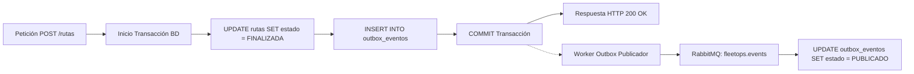

# Documento de Arquitectura de Software (DAS)

Este documento describe las metas, restricciones y decisiones arquitectónicas para el microservicio **Telemetría y Rutas** (`grupo_06_Telemetria`), evaluadas bajo la norma de calidad de producto de software **ISO/IEC 25010**.

---

## 1. Metas y Restricciones Arquitectónicas

1. **Aislamiento de Dominio (Database-per-Service):** Telemetría gestiona su propio almacén de datos relacional. Ningún otro microservicio accede directamente a su base de datos ni Telemetría consulta bases ajenas.
2. **Desacoplamiento Temporal (Event-Driven Architecture):** La propagación de estados y telemetría hacia Vehículos, Asignaciones y Combustible se realiza asíncronamente mediante RabbitMQ (`fleetops.events`), con garantía de entrega a través de **Transactional Outbox**.
3. **Resiliencia ante Fallas de Dependencias Externas:** Las llamadas síncronas hacia el microservicio de Asignaciones están protegidas mediante **Circuit Breaker** y timeouts estrictos.
4. **Idempotencia de Extremo a Extremo:** Cada evento consumido se valida contra una tabla de deduplicación (`eventos_procesados`) antes de aplicar cambios en base de datos.
5. **Simulación Geoespacial sin Dependencia de Hardware:** El cálculo de distancias y coordenadas se realiza mediante modelos matemáticos parametrizados (fórmula de Haversine con dispersión radial), abstraídos tras el patrón **Strategy** para permitir sustitución futura por telemetría GPS real sin alterar contratos.

---

## 2. Atributos de Calidad "Observables" (ISO 25010)

| Atributo de Calidad | Sub-característica | Descripción | Táctica / Patrón de Diseño | Aplicación Concreta en Telemetría |
| :--- | :--- | :--- | :--- | :--- |
| **Adecuación funcional** | *Completitud funcional* | El conjunto de funciones cubre todas las tareas y objetivos del usuario. | Pruebas Unitarias y de Integración | Validación integral de HU-01 a HU-06 en pipelines CI/CD. |
| **Adecuación funcional** | *Corrección funcional* | Capacidad del sistema para proveer resultados exactos. | Pruebas Unitarias automatizadas | Verificación de exactitud del cálculo de Haversine (redondeo a 2 decimales y distancia mínima de 0.50 km). |
| **Adecuación funcional** | *Pertinencia funcional* | Proporciona funciones que facilitan el logro de tareas específicas. | Pruebas Unitarias y Contratos | Validación de contratos de entrada/salida según casos de uso de Conductor, Combustible y Reportes. |
| **Compatibilidad** | *Coexistencia* | Compartir recursos en un entorno común sin detrimento mutuo. | Contenedorización (Docker) & Rate Limiting | Contenedor aislado con límites de CPU/RAM; cuotas por IP en API Gateway. |
| **Compatibilidad** | *Interoperabilidad* | Intercambio de información y uso de la misma entre sistemas heterogéneos. | Mensajería Asíncrona basada en Eventos + DTOs | Publicación de `telemetria.ruta.iniciada`, `telemetria.ruta.finalizada` y consumo con DTOs tipados. |
| **Capacidad de interacción** | *Asistencia al usuario* | Asistir al usuario para lograr objetivos específicos con facilidad. | Mensajes de Error Descriptivos y Resolutivos | Respuestas de error estandarizadas con `codigo`, `mensaje` y sugerencias de remediación. |
| **Capacidad de interacción** | *Aprendizabilidad* | Facilidad para aprender el uso del servicio en poco tiempo. | Interfaz Uniforme y OpenAPI (Swagger) | Estandarización de rutas REST y documentación viva interactiva en Swagger UI. |
| **Capacidad de interacción** | *Protección contra errores de usuario* | Prevenir errores en la operación antes de persistir datos corruptos. | DTO + Manejador Global de Excepciones | Validación de esquemas en entrada de endpoints antes de tocar la capa de datos. |
| **Capacidad de interacción** | *Operabilidad* | Facilitar la operación y control del sistema. | Feedback inmediato, consistencia semántica e idempotencia | Estados unívocos (`EN_CURSO`, `FINALIZADA`, `INTERRUMPIDA`) y respuestas consistentes. |
| **Capacidad de interacción** | *Auto-descriptividad* | Presentar información adecuada sin interacciones excesivas. | OpenAPI + Códigos HTTP Semánticos | Uso estricto de `200`, `201`, `400`, `404`, `409`, `503`. |
| **Fiabilidad** | *Ausencia de fallos* | Operar sin fallos bajo condiciones normales de trabajo. | Validación preventiva con DTOs + Tolerant Reader + DLQ | Mensajes de entrada en `q.telemetria` sin `asignacion_id` van directo a `q.telemetria.dlq` sin tumbar el servicio; campos extra se ignoran. |
| **Fiabilidad** | *Disponibilidad* | Estar accesible y operativo cuando se requiere. | Health Checks (`GET /health`) + Réplicas + Outbox | Sondeo de BD y RabbitMQ en < 150 ms para el ALB de AWS. Si el broker cae, `POST /rutas` sigue respondiendo `200` gracias al Outbox local. |
| **Fiabilidad** | *Tolerancia a fallos* | Operar según lo previsto en presencia de fallos hardware o software. | Circuit Breaker + Outbox + Reintentos con Backoff + ACID Rollback | Circuit breaker hacia Asignaciones (timeout 2s, 5 fallos = 30s open). 3 reintentos en consumidor antes de DLQ. Transacciones ACID con rollback ante errores de persistencia. |
| **Seguridad** | *Integridad* | Proteger el estado y datos frente a modificaciones no autorizadas o inconsistencias. | TLS/HTTPS + Transacciones ACID + Inmutabilidad + Restricciones de BD | Rutas inmutables (nunca se borran). Control de unicidad de asignación (evita carreras con 409). Coordenadas calculadas en backend para evitar manipulación del cliente. |
| **Seguridad** | *Responsabilidad* | Rastrear de forma inequívoca las acciones de las entidades. | Logs estructurados + Trazabilidad en BD + Correlación | Identificadores `asignacion_id`, `vehiculo_id`, `conductor_id`, `evento_id` y tablas `outbox_eventos` / `eventos_procesados`. |
| **Seguridad** | *Autenticidad* | Demostrar que la identidad de un sujeto o recurso es la afirmada. | JWT en API Gateway + Credenciales seguras en Broker | Validación de JWT antes de ingresar al servicio (excepto `GET /health` que es público). Credenciales de RabbitMQ mediante variables de entorno. |
| **Seguridad** | *Confidencialidad* | Asegurar que los datos solo sean accesibles por actores autorizados. | Base de Datos por Servicio + Secretos externalizados | Solo Telemetría tiene acceso a su BD. Secretos nunca en código; respuestas de error sin stack traces. |
| **Mantenibilidad** | *Reusabilidad* | Activos utilizables en múltiples componentes o servicios. | Patrón Strategy + Decorator + Sobre de Eventos Reutilizable | Algoritmo Haversine reutilizado en finalización (HU-03) e interrupción (HU-04). Librería interna del sobre estándar. |
| **Mantenibilidad** | *Analizabilidad* | Evaluar impacto de cambios y diagnosticar causas de fallos. | APM (Prometheus/Grafana) + Healthchecks + Logs con nivel ERROR | Monitoreo de latencia, tasa de errores y métricas operativas por endpoint. |
| **Mantenibilidad** | *Capacidad de modificación* | Modificar el código sin introducir defectos colaterales. | Principios SOLID + Patrón Strategy de Estados | Estados de ruta (`EN_CURSO`, `FINALIZADA`, `INTERRUMPIDA`) modelados con transiciones desacopladas. |
| **Mantenibilidad** | *Capacidad para ser probado* | Facilidad para establecer y ejecutar pruebas unitarias. | Inyección de Dependencias (DI) | Mockeo limpio de HTTP client (Asignaciones) y Broker (RabbitMQ) en pruebas unitarias. |
| **Flexibilidad** | *Adaptabilidad* | Adaptarse eficazmente a diferentes entornos operacionales. | Configuración Externalizada + Tolerant Reader + Adapter | Timeouts, URLs de broker y credenciales inyectadas por variables de entorno. Deserializador JSON tolerante a campos imprevistos. |
| **Flexibilidad** | *Escalabilidad* | Gestionar cargas crecientes adaptando la capacidad. | Diseño Stateless + Paginación + Índices Compuestos + Outbox | Múltiples instancias sin estado en RAM. Consultas paginadas (`page`, `size`) e índices `(estado, hora_inicio)` y `(asignacion_id, estado)`. |
| **Flexibilidad** | *Instalabilidad* | Facilidad para desplegarse o desinstalarse en cualquier entorno. | Orquestación Declarativa (`docker-compose`) + CI/CD | Despliegue con un solo comando levantando servicio, BD propia, exchange `fleetops.events`, `q.telemetria` y `q.telemetria.dlq`. |
| **Flexibilidad** | *Reemplazabilidad* | Capacidad de sustituirse por otro software sin alterar el entorno. | Patrón Strategy (Haversine vs GPS Real) + Contratos OpenAPI | La interfaz de cálculo de distancia permite enchufar un adaptador de GPS real sin modificar endpoints ni eventos. |
| **Protección** | *Restricción operativa* | Limitar funcionamiento a parámetros seguros ante peligros operativos. | Circuit Breaker y Fail-Fast | Rechazo inmediato de peticiones malformadas o en cascada cuando dependencias externas fallan. |
| **Protección** | *Identificación de riesgos* | Identificar situaciones u operaciones que exponen a riesgos inaceptables. | Patrón Domain Event | Emisión de eventos de auditoría y detección de inconsistencias operativas. |
| **Protección** | *Protección ante fallos* | Ponerse automáticamente en modo seguro en caso de fallo. | Database Transaction Management con Rollback | Si la base de datos o la red fallan durante una finalización, rollback completo y respuesta 503 controlada. |
| **Protección** | *Advertencia de peligro* | Alertar sobre riesgos con tiempo suficiente para reaccionar. | Event-Driven Messaging + Prometheus / Grafana Alerting | Alertas tempranas ante aumento de errores 5xx, saturación de la cola `q.telemetria` o apertura del Circuit Breaker. |

---

## 3. Atributos de Calidad "No Observables"

| Atributo | Sub-característica | Táctica / Patrón Arquitectónico | Aplicación Concreta en Telemetría |
| :--- | :--- | :--- | :--- |
| **Eficiencia de desempeño** | *Comportamiento temporal* | Load Testing + Consultas optimizadas por índices | P95 < 200 ms en validación para combustible (HU-02) y < 1.0 s en consulta paginada para reportes (HU-05). |
| **Eficiencia de desempeño** | *Utilización de recursos* | Paginación en BD + Cacheo local + Replicación | Consumo acotado de memoria eliminando respuestas no paginadas. Soporte de 500 req/s distribuidas. |
| **Capacidad de interacción** | *Operabilidad interna* | Patrón Command + Backend for Frontend (BFF) | Transiciones atómicas y trazables por comando de inicio/cierre. |
| **Fiabilidad** | *Capacidad de recuperación* | Backups automatizados + Volúmenes persistentes + Colas durables | Almacén persistente para las rutas (vital para odómetros de flota). Mensajes durables en RabbitMQ y preservación en DLQ. |
| **Seguridad** | *Resistencia a ataques* | Rate Limiting en API Gateway + Topes de paginación | Máximo `size=100` en `GET /rutas` para evitar ataques de denegación de servicio por agotamiento de memoria. Protección contra ráfagas en `POST /rutas/iniciar`. |
| **Mantenibilidad** | *Modularidad* | Arquitectura en Capas (Routes / Services / Repositories / Events) | Separación total entre la capa HTTP, la lógica de simulación/negocio, la capa de persistencia y los publicadores/consumidores de eventos. |
| **Flexibilidad** | *Adaptabilidad* | Contenedorización Docker + Database per Service | Empaquetado portable idéntico en desarrollo local y producción AWS EC2. |
| **Flexibilidad** | *Escalabilidad* | Competing Consumers + Replicación horizontal | Múltiples instancias consumiendo en paralelo de `q.telemetria` con balanceo HTTP respaldado por `GET /health`. |
| **Flexibilidad** | *Instalabilidad* | Pipeline CI/CD + Dockerfile multi-stage | Automatización en rama `main` con build, análisis estático y publicación de imágenes. |
| **Flexibilidad** | *Reemplazabilidad* | Gobierno de Contratos (`fleetops-contracts`) | Cumplimiento estricto de especificaciones OpenAPI y JSON Schemas para desacoplamiento total. |
| **Protección** | *Integración segura* | Quality Gate con SonarCloud + Pruebas de Integración | Verificación de contratos y políticas de calidad antes de cualquier despliegue a producción. |

---

## 4. Patrones de Diseño y Tácticas Clave

### 4.1. Transactional Outbox Pattern
Para garantizar que nunca se emita un evento de fin de ruta sin que la ruta haya quedado efectivamente guardada en la base de datos (o viceversa), el microservicio utiliza el patrón **Transactional Outbox**:
1. Al invocar `POST /rutas` (fin de ruta), se inicia una transacción en la base de datos.
2. Se actualiza el registro en la tabla `rutas` (estado `FINALIZADA`, distancia, etc.).
3. Se inserta un registro en la tabla `outbox_eventos` con el payload de `RutaFinalizadaEvent` y estado `PENDIENTE`.
4. Se hace commit de la transacción.
5. Un proceso en segundo plano (o disparador) publica los eventos pendientes al broker RabbitMQ. Al recibir la confirmación del broker, el registro pasa a `PUBLICADO`.
6. Si RabbitMQ está caído temporalmente, el cliente HTTP recibe `200 OK` de inmediato y el evento se despacha automáticamente una vez restablecida la conexión.



### 4.2. Circuit Breaker Pattern (Llamada a Asignaciones)
* **Destino:** Microservicio de Asignaciones (`GET /asignaciones/{id}`).
* **Timeout configurado:** `2.0 segundos` (por variable de entorno).
* **Umbral de apertura:** `5 fallos consecutivos`.
* **Tiempo de circuito abierto (Sleep Window):** `30 segundos`.
* **Comportamiento en circuito abierto:** Responde de inmediato `503 DEPENDENCIA_NO_DISPONIBLE` sin emitir peticiones por la red, protegiendo al servicio cliente y permitiendo la recuperación del servicio upstream.

### 4.3. Idempotent Consumer & Tolerant Reader
* **Idempotencia:** Cada mensaje entrante en `q.telemetria` incluye un `evento_id`. El consumidor valida su existencia en la tabla `eventos_procesados`. Si ya existe, se confirma (ACK manual) sin reejecutar la lógica de negocio.
* **Tolerant Reader:** El parser JSON únicamente extrae los campos obligatorios del sobre (`evento_id`, `tipo_evento`, `datos.asignacion_id`). Campos adicionales enviados por otros microservicios (como `incidente_id` o `reasignacion_resultado`) se ignoran silenciosamente.
* **Dead Letter Queue (DLQ):** Mensajes malformados, JSON inválido o sin `asignacion_id` se envían inmediatamente a `q.telemetria.dlq` sin reintentos, registrando la alerta en los logs con nivel `ERROR`.

### 4.4. Strategy Pattern (Simulación Haversine vs Hardware GPS)
* La lógica de cálculo de distancias y generación de coordenadas se aísla bajo una interfaz abstracta:
  ```typescript
  interface IGeoLocationProvider {
    calcularRuta(origen: Coordenada, inicio: Date, fin: Date): ResultadoSimulacion;
  }
  ```
* En la fase actual, la implementación activa es `HaversineSimulationStrategy`. Si en el futuro se incorporan dispositivos IoT/GPS reales, se implementa `GpsHardwareProvider` sin alterar la lógica de negocio, los controladores ni los eventos.
