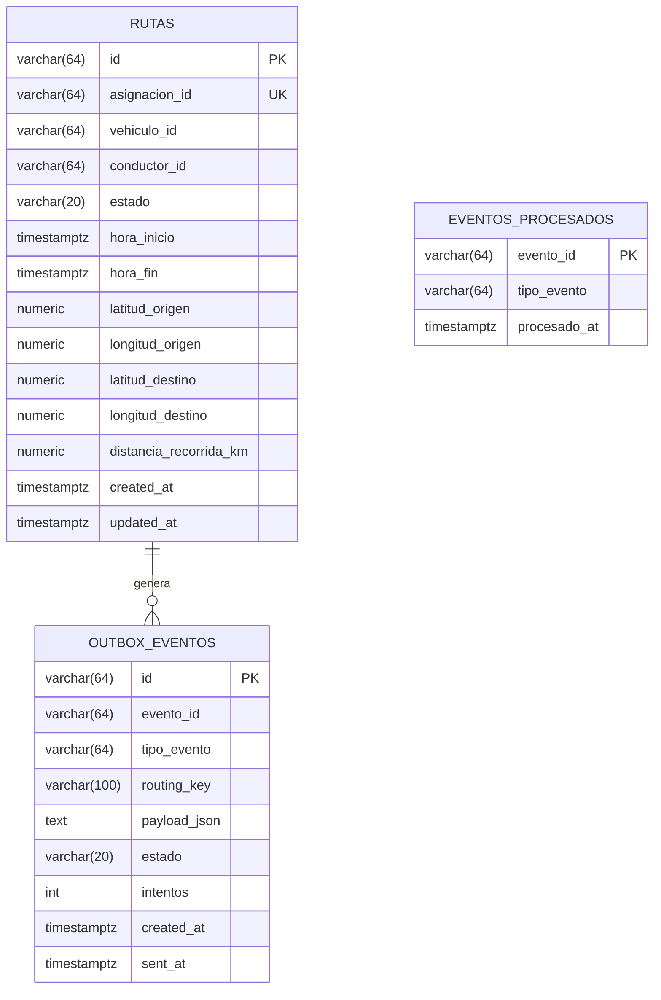

# Contratos de API REST, Eventos y Modelo de Datos

Este documento define los contratos de interfaz REST, las especificaciones de eventos sobre **AWS SNS/SQS** y el esquema relacional del microservicio **Telemetría y Rutas** (`grupo_06_Telemetria`). Su fuente de verdad es la sección **10. Especificación Técnica** del Documento de Arquitectura de Software (DAS v2, 29/10/2026): **10.1 Tabla de eventos**, **10.2 Tabla de endpoints** y **10.3 Modelo relacional**.

---

## 1. Catálogo de Errores Estandarizados

Todos los errores retornados por la API REST siguen la misma estructura JSON:

```json
{
  "codigo": "CODIGO_ERROR",
  "mensaje": "Descripción legible del error",
  "errores": [
    {
      "campo": "nombre_campo",
      "detalle": "Razón del fallo de validación"
    }
  ]
}
```

| Código | HTTP Status | Causa | Mensaje sugerido |
| :--- | :--- | :--- | :--- |
| `DATOS_INVALIDOS` | `400 Bad Request` | Campo requerido ausente, vacío o fuera de rango. | `"El campo <campo> es obligatorio"` o detalle en `errores`. |
| `JSON_INVALIDO` | `400 Bad Request` | El cuerpo de la petición no es un JSON bien formado. | `"El formato del cuerpo JSON es inválido"` |
| `ASIGNACION_NO_ENCONTRADA` | `404 Not Found` | La asignación no existe en el MS Asignaciones (HU-01). | `"No existe una asignación con id <asignacion_id>"` |
| `ASIGNACION_NO_PENDIENTE` | `409 Conflict` | La asignación no está en estado `PENDIENTE`. | `"La asignación no se encuentra en estado PENDIENTE para iniciar ruta"` |
| `RUTA_DUPLICADA` | `409 Conflict` | Ya existe una ruta asociada a esa asignación. | `"Ya existe una ruta registrada para la asignación <asignacion_id>"` |
| `RUTA_NO_ENCONTRADA` | `404 Not Found` | No existe la ruta (por `id` o por `asignacion_id`). | `"No existe una ruta asociada a <id o asignacion_id>"` |
| `ESTADO_RUTA_INVALIDO` | `409 Conflict` | La ruta no está `EN_CURSO` al intentar finalizarla. | `"La ruta no se encuentra en estado EN_CURSO para ser finalizada"` |
| `DEPENDENCIA_NO_DISPONIBLE` | `503 Service Unavailable` | Timeout (`2.0 s`) o Circuit Breaker abierto hacia Asignaciones. | `"No fue posible validar la asignación, intente nuevamente"` |
| `SERVICIO_NO_DISPONIBLE` | `503 Service Unavailable` | Fallo de la base de datos PostgreSQL de Telemetría. | `"Servicio de persistencia no disponible"` |
| `SERVICIO_DEGRADADO` | `503 Service Unavailable` | Fallo del sondeo de BD o de AWS SNS/SQS en `/health`. | `"Dependencias de infraestructura no disponibles"` |

---

## 2. Endpoints REST (DAS §10.2)

### 2.1. Tabla de Endpoints

| Método | Ruta / Endpoint | Historia | Descripción | Respuestas HTTP |
| :--- | :--- | :--- | :--- | :--- |
| `POST` | `/rutas/iniciar` | HU-01 | Inicia el recorrido de una ruta asociada a una asignación operativa previa validación de estado. | `201 Created`, `400 Bad Request`, `409 Conflict`, `503 Service Unavailable` |
| `GET` | `/rutas/asignacion/{asignacion_id}` | HU-01 / HU-03 | Permite al conductor consultar la información de la ruta (en curso o finalizada) asociada a su asignación específica. | `200 OK`, `404 Not Found` |
| `POST` | `/rutas` | HU-03 | Finaliza una ruta activa, calcula la distancia recorrida y registra las métricas finales. | `200 OK`, `400 Bad Request`, `404 Not Found`, `409 Conflict` |
| `GET` | `/rutas/{id}` | HU-01 / HU-03 | Obtiene el detalle específico de una ruta mediante su identificador único UUID. | `200 OK`, `404 Not Found` |
| `GET` | `/health` | HU-06 | Endpoint público de verificación de salud del microservicio, base de datos y broker. | `200 OK`, `503 Service Unavailable` |

### 2.2. Seguridad, Roles y Timeouts

| Ruta / Endpoint | Actor | Gateway Auth | Rol | Timeout | Nota |
| :--- | :--- | :--- | :--- | :--- | :--- |
| `POST /rutas/iniciar` | Conductor | JWT Bearer Token | `CONDUCTOR` | `2.0 s` | Valida con MS Asignaciones síncronamente vía Circuit Breaker. |
| `GET /rutas/asignacion/{asignacion_id}` | Conductor / Frontend | JWT Bearer Token | `CONDUCTOR` | `1.0 s` | Consulta el estado/detalles de la ruta asignada al conductor. |
| `POST /rutas` | Conductor | JWT Bearer Token | `CONDUCTOR` | `2.0 s` | Publica el evento asíncrono `route_completed_event` vía Outbox. |
| `GET /rutas/{id}` | Conductor / Frontend | JWT Bearer Token | `CONDUCTOR` | `1.0 s` | Obtiene el detalle de la ruta por UUID para la app del conductor. |
| `GET /health` | Monitoreo / ALB | Público | `N/A` | `150 ms` | Sondeo de salud para el balanceador de carga AWS y el orquestador. |

---

### 2.3. Iniciar Ruta — `POST /rutas/iniciar` (HU-01)

Inicia formalmente un recorrido fijando la salida en el Centro de Operaciones de FleetCorp (`3.4516, -76.5320`). El frontend **no** envía coordenadas.

* **Headers:** `Content-Type: application/json`, `Authorization: Bearer <jwt_token>`
* **Solicitud:**
  ```json
  {
    "asignacion_id": "f47ac10b-58cc-4372-a567-0e02b2c3d479"
  }
  ```
* **Respuesta `201 Created`:**
  ```json
  {
    "id": "c9bf9e57-1685-4c89-bafb-ff5af830be8a",
    "asignacion_id": "f47ac10b-58cc-4372-a567-0e02b2c3d479",
    "vehiculo_id": "a3bb189e-8bf9-3888-9912-ace4e6543001",
    "conductor_id": "7c9e6679-7425-40de-944b-e07fc1f90ae7",
    "estado": "EN_CURSO",
    "hora_inicio": "2026-10-29T08:00:00Z",
    "origen_latitud": 3.4516,
    "origen_longitud": -76.5320
  }
  ```
* **Errores:**
  * `400`: `DATOS_INVALIDOS` / `JSON_INVALIDO`.
  * `404`: `ASIGNACION_NO_ENCONTRADA` *(criterio de HU-01; ver §6)*.
  * `409`: `ASIGNACION_NO_PENDIENTE` / `RUTA_DUPLICADA`.
  * `503`: `DEPENDENCIA_NO_DISPONIBLE` (Circuit Breaker hacia Asignaciones) / `SERVICIO_NO_DISPONIBLE` (BD local).
* **Efecto asíncrono:** publica `route_started_event` en AWS SNS (ver §3).

---

### 2.4. Consultar Ruta por Asignación — `GET /rutas/asignacion/{asignacion_id}` (HU-01 / HU-03)

Permite al conductor consultar la ruta asociada a su asignación (`EN_CURSO`, `FINALIZADA` o `INTERRUMPIDA`).

* **Headers:** `Authorization: Bearer <jwt_token>`
* **Respuesta `200 OK`** (ruta en curso: `hora_fin`, `distancia_recorrida_km` y `destino` en `null`):
  ```json
  {
    "id": "c9bf9e57-1685-4c89-bafb-ff5af830be8a",
    "asignacion_id": "f47ac10b-58cc-4372-a567-0e02b2c3d479",
    "vehiculo_id": "a3bb189e-8bf9-3888-9912-ace4e6543001",
    "conductor_id": "7c9e6679-7425-40de-944b-e07fc1f90ae7",
    "estado": "EN_CURSO",
    "hora_inicio": "2026-10-29T08:00:00Z",
    "hora_fin": null,
    "distancia_recorrida_km": null,
    "origen": { "latitud": 3.4516, "longitud": -76.5320 },
    "destino": null
  }
  ```
* **Errores:** `404 RUTA_NO_ENCONTRADA` si la asignación no tiene ruta registrada.

---

### 2.5. Finalizar Ruta — `POST /rutas` (HU-03)

Cierra la ruta activa, calcula la distancia con la fórmula de Haversine (redondeo a 2 decimales, mínimo `0.50 km` si la duración es menor a 1 minuto) y propaga el kilometraje. Si no se envían coordenadas de destino, el servidor genera un destino simulado en un radio de 5 a 25 km.

* **Headers:** `Content-Type: application/json`, `Authorization: Bearer <jwt_token>`
* **Solicitud:**
  ```json
  {
    "asignacion_id": "f47ac10b-58cc-4372-a567-0e02b2c3d479",
    "destino_latitud": 3.4372,
    "destino_longitud": -76.5225
  }
  ```
* **Respuesta `200 OK`:**
  ```json
  {
    "id": "c9bf9e57-1685-4c89-bafb-ff5af830be8a",
    "asignacion_id": "f47ac10b-58cc-4372-a567-0e02b2c3d479",
    "estado": "FINALIZADA",
    "hora_inicio": "2026-10-29T08:00:00Z",
    "hora_fin": "2026-10-29T10:30:00Z",
    "distancia_recorrida_km": 18.45,
    "origen": {
      "latitud": 3.4516,
      "longitud": -76.5320
    },
    "destino": {
      "latitud": 3.4372,
      "longitud": -76.5225
    }
  }
  ```
* **Errores:**
  * `400`: `DATOS_INVALIDOS` / `JSON_INVALIDO`.
  * `404`: `RUTA_NO_ENCONTRADA`.
  * `409`: `ESTADO_RUTA_INVALIDO` (la ruta ya estaba `FINALIZADA` o `INTERRUMPIDA`).
  * `503`: `SERVICIO_NO_DISPONIBLE` *(criterio de HU-03; ver §6)*.
* **Efecto asíncrono:** inserta `route_completed_event` en `outbox_eventos` en la misma transacción y el worker lo publica en AWS SNS. Si SNS no está disponible, la respuesta `200 OK` no falla.

---

### 2.6. Detalle de Ruta por ID — `GET /rutas/{id}` (HU-01 / HU-03)

* **Headers:** `Authorization: Bearer <jwt_token>`
* **Respuesta `200 OK`:**
  ```json
  {
    "id": "c9bf9e57-1685-4c89-bafb-ff5af830be8a",
    "asignacion_id": "f47ac10b-58cc-4372-a567-0e02b2c3d479",
    "vehiculo_id": "a3bb189e-8bf9-3888-9912-ace4e6543001",
    "conductor_id": "7c9e6679-7425-40de-944b-e07fc1f90ae7",
    "estado": "FINALIZADA",
    "hora_inicio": "2026-10-29T08:00:00Z",
    "hora_fin": "2026-10-29T10:30:00Z",
    "distancia_recorrida_km": 18.45,
    "origen": { "latitud": 3.4516, "longitud": -76.5320 },
    "destino": { "latitud": 3.4372, "longitud": -76.5225 }
  }
  ```
* **Errores:** `404 RUTA_NO_ENCONTRADA`.

---

### 2.7. Salud y Diagnóstico — `GET /health` (HU-06)

Endpoint público para el AWS ALB y el orquestador de contenedores. **No requiere JWT.**

* **Sondeo activo (timeout de 1.0 s por dependencia; respuesta total < 150 ms):**
  * PostgreSQL: `SELECT 1`.
  * AWS SNS/SQS: verificación de acceso al tópico `fleetops-events` y a la cola `q.telemetria`.
* **Respuesta `200 OK`:**
  ```json
  {
    "status": "UP",
    "database": "UP",
    "broker": "UP",
    "timestamp": "2026-10-29T16:27:00Z"
  }
  ```
* **Respuesta `503 Service Unavailable`** (`SERVICIO_DEGRADADO`):
  ```json
  {
    "status": "DOWN",
    "database": "DOWN",
    "broker": "UP",
    "timestamp": "2026-10-29T16:27:00Z"
  }
  ```

---

### 2.8. Listado Paginado — `GET /rutas` (HU-05, Proceso 6)

> [!NOTE]
> Este endpoint **no aparece en la tabla 10.2** del DAS, pero sí está declarado en el DAS §7 (Macro Arquitectura) y §7.1: *"El MS de Reportes Operativos consulta `GET /rutas` con filtros y paginación"*. Se documenta aquí para no romper el contrato con Reportes Operativos.

* **Query params opcionales:** `asignacion_id`, `vehiculo_id`, `estado` (`EN_CURSO` | `FINALIZADA` | `INTERRUMPIDA`), `fecha_desde` y `fecha_hasta` (`AAAA-MM-DD`), `page` (≥ 0, por defecto `0`) y `size` (1 a 100, por defecto `20`).
* **Respuesta `200 OK`** (orden descendente por `hora_inicio`; si no hay resultados devuelve `contenido: []` y `total: 0`, nunca `404`):
  ```json
  {
    "contenido": [
      {
        "id": "c9bf9e57-1685-4c89-bafb-ff5af830be8a",
        "asignacion_id": "f47ac10b-58cc-4372-a567-0e02b2c3d479",
        "vehiculo_id": "a3bb189e-8bf9-3888-9912-ace4e6543001",
        "estado": "FINALIZADA",
        "hora_inicio": "2026-10-29T08:00:00Z",
        "hora_fin": "2026-10-29T10:30:00Z",
        "distancia_recorrida_km": 18.45
      }
    ],
    "page": 0,
    "size": 20,
    "total": 1
  }
  ```
* **Errores:** `400 DATOS_INVALIDOS`, `503 SERVICIO_NO_DISPONIBLE`.
* **Rendimiento:** < 1.0 s, respaldado por el índice `(estado, hora_inicio)`.

---

## 3. Contratos de Mensajería y Eventos — AWS SNS/SQS (DAS §10.1)

### 3.1. Infraestructura de Mensajería

| Recurso | Servicio AWS | Uso |
| :--- | :--- | :--- |
| `fleetops-events` (`fleetops-telemetria_events`) | Tópico **SNS** | Telemetría publica `route_started_event` y `route_completed_event`. Los suscriptores de cada microservicio reciben los eventos en sus propias colas. |
| `q.telemetria` | Cola **SQS** | Cola propia de Telemetría, suscrita al tópico SNS. De aquí se consume `severe_incident_reported_event`. |
| `q.telemetria.dlq` | Cola **SQS** (DLQ) | Recibe los mensajes malformados (sin reintentos) y los que fallan tras 3 reintentos. |

> [!IMPORTANT]
> Las URLs/ARNs del tópico y de las colas, la región y las credenciales/rol IAM se leen **siempre de variables de entorno**; nunca se escriben en el código.

### 3.2. Tabla de Eventos

| Nombre del evento | Tipo | Canal / Tópico / Cola | Origen / Destino | Descripción y patrón | Dead Letter Queue (DLQ) |
| :--- | :--- | :--- | :--- | :--- | :--- |
| `route_started_event` | Publicado | `fleetops-telemetria_events` (AWS SNS) | Telemetría → Asignaciones / Vehículos / Combustible / Reportes Operativos | Notifica el inicio formal del recorrido. Se publica mediante **Transactional Outbox** (se guarda en `outbox_eventos` dentro de la transacción ACID) hacia el tópico SNS `fleetops-events`. Combustible y Reportes guardan la información con el patrón **Event-Carried State Transfer**. | N/A (gestionado por suscriptores) |
| `route_completed_event` | Publicado | `fleetops-telemetria_events` (AWS SNS) | Telemetría → Vehículos / Asignaciones | Notifica la conclusión (`FINALIZADA`) o la interrupción (`INTERRUMPIDA`) del trayecto con la distancia recorrida. Usa **Transactional Outbox**. | N/A (gestionado por suscriptores) |
| `severe_incident_reported_event` | Consumido | `q.telemetria` (AWS SQS) | Incidentes → Telemetría | Indica la interrupción por incidente grave. Se procesa con **Idempotent Consumer** (registro de `evento_id` en `eventos_procesados`) y **Tolerant Reader**. | `q.telemetria.dlq` (AWS SQS) |

### 3.3. Componentes de Infraestructura y Patrones de Resiliencia

* **Transactional Outbox:** los eventos se guardan en la tabla local `outbox_eventos` dentro de la misma transacción ACID que el cambio de estado de la ruta. Un proceso en segundo plano los publica en el tópico AWS SNS `fleetops-events`, lo que garantiza entrega **al menos una vez** (*at-least-once delivery*) aunque el servicio de mensajería no esté disponible en ese momento.
* **Idempotent Consumer (Inbox):** garantiza que cada evento se procese una sola vez a nivel de aplicación registrando el `evento_id` en `eventos_procesados`. Un mensaje duplicado se descarta sin volver a ejecutar la lógica de negocio y se confirma su eliminación de la cola (`DeleteMessage` en SQS).
* **Tolerant Reader:** del mensaje entrante solo se exigen `evento_id`, `tipo_evento` y `asignacion_id`; los demás campos se ignoran sin error.
* **Dead Letter Queue:** los mensajes con JSON inválido o sin `asignacion_id` se envían directamente a `q.telemetria.dlq`; los fallos transitorios de BD se reintentan hasta 3 veces antes de ir a la DLQ.

---

### 3.4. Sobre Estándar (*Event Envelope*)

Todos los eventos emitidos y consumidos comparten esta estructura:

| Campo | Tipo | Descripción |
| :--- | :--- | :--- |
| `evento_id` | `string` (UUID v4) | Identificador único del evento; clave de idempotencia. |
| `tipo_evento` | `string` | `route_started_event`, `route_completed_event` o `severe_incident_reported_event`. |
| `origen` | `string` | Servicio emisor (`fleetops-telemetria` para los eventos propios). |
| `timestamp` | `string` (ISO-8601 UTC) | Momento en que ocurrió el evento. |
| `version` | `string` | Versión del esquema del evento (`1.0`). |
| `payload` | `object` | Datos específicos del evento. |

---

### 3.5. Eventos Publicados por Telemetría

#### A. `route_started_event` (HU-01)
* **Se publica cuando:** se confirma en la BD local el inicio de la ruta.
* **Consumidores:** Asignaciones (cambia la asignación a `EN_CURSO`), Vehículos, Combustible y Reportes Operativos (Event-Carried State Transfer).

```json
{
  "evento_id": "3b29a1f4-90e8-4c12-b34e-89a1c89f0123",
  "tipo_evento": "route_started_event",
  "origen": "fleetops-telemetria",
  "timestamp": "2026-10-29T08:00:00Z",
  "version": "1.0",
  "payload": {
    "ruta_id": "c9bf9e57-1685-4c89-bafb-ff5af830be8a",
    "asignacion_id": "f47ac10b-58cc-4372-a567-0e02b2c3d479",
    "vehiculo_id": "a3bb189e-8bf9-3888-9912-ace4e6543001",
    "conductor_id": "7c9e6679-7425-40de-944b-e07fc1f90ae7",
    "estado": "EN_CURSO",
    "hora_inicio": "2026-10-29T08:00:00Z"
  }
}
```

#### B. `route_completed_event` (HU-03 y HU-04)
* **Se publica cuando:** la ruta se finaliza normalmente (HU-03, `estado: "FINALIZADA"`) o se interrumpe por un incidente grave (HU-04, `estado: "INTERRUMPIDA"` con la distancia parcial simulada).
* **Consumidores:**
  * **Vehículos:** suma `distancia_recorrida_km` a su `kilometraje_actual`.
  * **Asignaciones:** cambia la asignación a `FINALIZADA` (si ya está en `INTERRUMPIDA_POR_INCIDENTE`, ignora el evento).

```json
{
  "evento_id": "7f8a912b-10c9-4b34-89d1-02b4d5e6f789",
  "tipo_evento": "route_completed_event",
  "origen": "fleetops-telemetria",
  "timestamp": "2026-10-29T10:30:00Z",
  "version": "1.0",
  "payload": {
    "ruta_id": "c9bf9e57-1685-4c89-bafb-ff5af830be8a",
    "asignacion_id": "f47ac10b-58cc-4372-a567-0e02b2c3d479",
    "vehiculo_id": "a3bb189e-8bf9-3888-9912-ace4e6543001",
    "conductor_id": "7c9e6679-7425-40de-944b-e07fc1f90ae7",
    "estado": "FINALIZADA",
    "hora_inicio": "2026-10-29T08:00:00Z",
    "hora_fin": "2026-10-29T10:30:00Z",
    "distancia_recorrida_km": 18.45
  }
}
```

---

### 3.6. Eventos Consumidos por Telemetría

#### A. `severe_incident_reported_event` (HU-04, Proceso 2B)
* **Origen:** MS Incidentes, al registrar un incidente grave (`cancela_ruta: true`).
* **Cola:** `q.telemetria` (AWS SQS) → DLQ `q.telemetria.dlq`.
* **Acción en Telemetría:**
  1. Si el `evento_id` ya está en `eventos_procesados`, confirma el mensaje y termina.
  2. Busca la ruta `EN_CURSO` de `asignacion_id`. Si no existe o ya está cerrada, confirma el mensaje y registra un log `INFO`.
  3. Calcula la distancia parcial con Haversine, cambia la ruta a `INTERRUMPIDA` (nunca la borra) y, en la misma transacción, registra el `evento_id` y escribe `route_completed_event` con `estado: "INTERRUMPIDA"` en `outbox_eventos`.
* **Ejemplo de mensaje esperado** (solo `evento_id`, `tipo_evento` y `payload.asignacion_id` son obligatorios; el resto se ignora por *Tolerant Reader*):

```json
{
  "evento_id": "b1d2c3e4-5f60-4a7b-8c9d-0e1f2a3b4c5d",
  "tipo_evento": "severe_incident_reported_event",
  "origen": "fleetops-incidentes",
  "timestamp": "2026-10-29T09:15:00Z",
  "version": "1.0",
  "payload": {
    "incidente_id": "e2f3a4b5-6c7d-4e8f-9a0b-1c2d3e4f5a6b",
    "asignacion_id": "f47ac10b-58cc-4372-a567-0e02b2c3d479",
    "vehiculo_id": "a3bb189e-8bf9-3888-9912-ace4e6543001",
    "conductor_id": "7c9e6679-7425-40de-944b-e07fc1f90ae7",
    "tipo": "GRAVE",
    "cancela_ruta": true,
    "coordenadas": { "latitud": 3.4401, "longitud": -76.5260 }
  }
}
```

---

## 4. Modelo de Datos Relacional (DAS §7.2 y §10.3)

Bajo el patrón **Database-per-Service**, la base PostgreSQL (Supabase) solo es accesible por Telemetría. El DAS define tres tablas núcleo:



### Definición DDL

```sql
-- Historial inmutable de recorridos
CREATE TABLE rutas (
    id                     VARCHAR(64) PRIMARY KEY,
    asignacion_id          VARCHAR(64) NOT NULL UNIQUE,
    vehiculo_id            VARCHAR(64) NOT NULL,
    conductor_id           VARCHAR(64) NOT NULL,
    estado                 VARCHAR(20) NOT NULL
                           CHECK (estado IN ('EN_CURSO', 'FINALIZADA', 'INTERRUMPIDA')),
    hora_inicio            TIMESTAMPTZ NOT NULL,
    hora_fin               TIMESTAMPTZ,
    latitud_origen         NUMERIC(10, 6) NOT NULL DEFAULT 3.451600,
    longitud_origen        NUMERIC(10, 6) NOT NULL DEFAULT -76.532000,
    latitud_destino        NUMERIC(10, 6),
    longitud_destino       NUMERIC(10, 6),
    distancia_recorrida_km NUMERIC(12, 2),
    created_at             TIMESTAMPTZ NOT NULL DEFAULT CURRENT_TIMESTAMP,
    updated_at             TIMESTAMPTZ NOT NULL DEFAULT CURRENT_TIMESTAMP
);

-- Índices compuestos (DAS §7.2)
CREATE INDEX idx_rutas_estado_hora_inicio ON rutas (estado, hora_inicio DESC);  -- HU-05 (< 1.0 s)
CREATE INDEX idx_rutas_asignacion_estado  ON rutas (asignacion_id, estado);     -- HU-02 (P95 < 200 ms)
CREATE INDEX idx_rutas_vehiculo_fecha     ON rutas (vehiculo_id, hora_inicio DESC);

-- Transactional Outbox (eventos pendientes y publicados hacia AWS SNS)
CREATE TABLE outbox_eventos (
    id           VARCHAR(64) PRIMARY KEY,
    evento_id    VARCHAR(64) NOT NULL,
    tipo_evento  VARCHAR(64) NOT NULL,   -- route_started_event | route_completed_event
    routing_key  VARCHAR(100) NOT NULL,  -- atributo de mensaje SNS para filter policies
    payload_json TEXT NOT NULL,          -- sobre estándar completo
    estado       VARCHAR(20) NOT NULL DEFAULT 'PENDIENTE'
                 CHECK (estado IN ('PENDIENTE', 'PUBLICADO', 'FALLIDO')),
    intentos     INT NOT NULL DEFAULT 0,
    created_at   TIMESTAMPTZ NOT NULL DEFAULT CURRENT_TIMESTAMP,
    sent_at      TIMESTAMPTZ
);

CREATE INDEX idx_outbox_estado ON outbox_eventos (estado, created_at);

-- Idempotent Consumer (deduplicación de eventos consumidos desde SQS)
CREATE TABLE eventos_procesados (
    evento_id    VARCHAR(64) PRIMARY KEY,
    tipo_evento  VARCHAR(64) NOT NULL,
    procesado_at TIMESTAMPTZ NOT NULL DEFAULT CURRENT_TIMESTAMP
);
```

> [!NOTE]
> El diagrama [modelo_relacional.jpg](img/modelo_relacional.jpg) usa nombres en inglés (`routes`, `outbox_events`, `processed_events`) y agrega dos tablas de trazabilidad opcionales: `logs` (auditoría de operaciones y errores) y `events` (historial de eventos entrantes y salientes). Los nombres en español de esta sección son los que usan el texto del DAS y el código actual (`app/infrastructure/db/orm_models.py`).

---

## 5. Correspondencia Historia → Endpoint / Evento

| Historia | Endpoint(s) | Evento(s) |
| :--- | :--- | :--- |
| HU-01 Iniciar ruta | `POST /rutas/iniciar`, `GET /rutas/asignacion/{asignacion_id}`, `GET /rutas/{id}` | Publica `route_started_event` |
| HU-02 Ruta en curso para Combustible | Consulta local (sin llamadas HTTP salientes) | — |
| HU-03 Finalizar ruta | `POST /rutas`, `GET /rutas/asignacion/{asignacion_id}`, `GET /rutas/{id}` | Publica `route_completed_event` (`FINALIZADA`) |
| HU-04 Interrupción por incidente | — | Consume `severe_incident_reported_event`; publica `route_completed_event` (`INTERRUMPIDA`) |
| HU-05 Historial de rutas | `GET /rutas` (DAS §7) | — |
| HU-06 Salud | `GET /health` | — |

---

## 6. Notas de Consistencia con el DAS

Estas diferencias se encontraron al contrastar el DAS con el Product Backlog. Se recomienda resolverlas en la próxima versión del DAS:

1. **`POST /rutas/iniciar`:** la tabla 10.2 no lista `404 Not Found`, pero HU-01 exige `404 ASIGNACION_NO_ENCONTRADA` cuando Asignaciones no encuentra la asignación.
2. **`POST /rutas`:** la tabla 10.2 no lista `503 Service Unavailable`, pero HU-03 exige `503 SERVICIO_NO_DISPONIBLE` si falla la base de datos.
3. **`GET /rutas`:** aparece en el DAS §7 / §7.1 (consumido por Reportes Operativos), pero no en la tabla 10.2.
4. **Nombres de eventos:** el DAS §7.1 usa los routing keys `telemetria.ruta.iniciada`, `telemetria.ruta.finalizada` y `asignaciones.asignacion.interrumpida`, mientras que la tabla 10.1 usa `route_started_event`, `route_completed_event` y `severe_incident_reported_event`. Este documento toma como oficial la tabla 10.1 para `tipo_evento` y conserva los routing keys como atributo `routing_key` del mensaje SNS.
