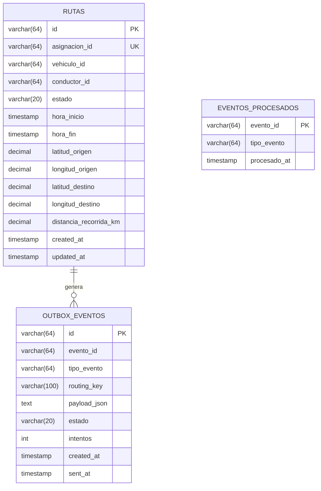

# Contratos de API REST, Eventos y Modelo de Datos

Este documento define con precisión técnica los contratos de interfaz REST, las especificaciones de eventos para el broker RabbitMQ y el esquema relacional de base de datos para el microservicio **Telemetría y Rutas**.

---

## 1. Catálogo de Errores Estandarizados

Todos los errores retornados por la API REST siguen la siguiente estructura JSON uniforme:

```json
{
  "codigo": "CODIGO_ERROR",
  "mensaje": "Descripción legible del error",
  "errores": [
    {
      "campo": "nombre_campo",
      "detalle": "Razón del fallo de validación"
    }
  ]
}
```

### Tabla de Códigos de Error

| Código | HTTP Status | Causa | Mensaje Sugerido |
| :--- | :--- | :--- | :--- |
| `DATOS_INVALIDOS` | `400 Bad Request` | Campo requerido ausente, vacío o fuera de rango. | `"El campo <campo> es obligatorio"` o detalle en `errores`. |
| `JSON_INVALIDO` | `400 Bad Request` | Cuerpo de la petición no es un JSON bien formado. | `"El formato del cuerpo JSON es inválido"` |
| `ASIGNACION_NO_ENCONTRADA`| `404 Not Found` | Asignación inexistente en el MS Asignaciones. | `"No existe una asignación con id <asignacion_id>"` |
| `ASIGNACION_NO_PENDIENTE` | `409 Conflict` | Asignación no está en estado `PENDIENTE`. | `"La asignación no se encuentra en estado PENDIENTE para iniciar ruta"` |
| `RUTA_DUPLICADA` | `409 Conflict` | Ya existe una ruta asociada a esa asignación. | `"Ya existe una ruta registrada para la asignación <asignacion_id>"` |
| `RUTA_NO_ENCONTRADA` | `404 Not Found` | No existe la ruta en la base de datos de telemetría. | `"No existe una ruta con id <id>"` |
| `ESTADO_RUTA_INVALIDO` | `409 Conflict` | La ruta no se encuentra en estado `EN_CURSO` al finalizar. | `"La ruta no se encuentra en estado EN_CURSO para ser finalizada"` |
| `DEPENDENCIA_NO_DISPONIBLE`| `503 Service Unavailable`| Timeout o Circuit Breaker abierto hacia Asignaciones. | `"No fue posible validar la asignación, intente nuevamente"` |
| `SERVICIO_NO_DISPONIBLE` | `503 Service Unavailable`| Fallo en la base de datos relacional local de telemetría. | `"Servicio de persistencia no disponible"` |
| `SERVICIO_DEGRADADO` | `503 Service Unavailable`| Fallo en sondeo de BD o broker en `/health`. | `"Dependencias de infraestructura no disponibles"` |

---

## 2. Endpoints REST

### 2.1. Iniciar Ruta (`POST /rutas/iniciar`)
Inicia formalmente un recorrido fijando la salida en el Centro de Operaciones. Requiere autenticación JWT en Gateway.

* **Headers:** `Content-Type: application/json`, `Authorization: Bearer <jwt_token>`
* **Request Body:**
  ```json
  {
    "asignacion_id": "asig-8472"
  }
  ```

* **Respuestas:**
  * **`201 Created`**:
    ```json
    {
      "id": "ruta-1001",
      "asignacion_id": "asig-8472",
      "vehiculo_id": "veh-501",
      "conductor_id": "cond-101",
      "estado": "EN_CURSO",
      "hora_inicio": "2026-10-05T08:00:00Z",
      "coordenada_origen": {
        "latitud": 3.4516,
        "longitud": -76.5320
      }
    }
    ```
  * **`400 Bad Request`**: `DATOS_INVALIDOS` o `JSON_INVALIDO`.
  * **`404 Not Found`**: `ASIGNACION_NO_ENCONTRADA`.
  * **`409 Conflict`**: `ASIGNACION_NO_PENDIENTE` o `RUTA_DUPLICADA`.
  * **`503 Service Unavailable`**: `DEPENDENCIA_NO_DISPONIBLE` (Circuit Breaker / Asignaciones) o `SERVICIO_NO_DISPONIBLE` (BD local).

---

### 2.2. Finalizar Ruta (`POST /rutas`)
Registra la orden de cierre de viaje, calcula la distancia simulada (Haversine) y propaga el odómetro. Requiere JWT.

* **Headers:** `Content-Type: application/json`, `Authorization: Bearer <jwt_token>`
* **Request Body:**
  ```json
  {
    "asignacion_id": "asig-8472"
  }
  ```
  *(Nota: Acepta también `ruta_id` alternativamente)*

* **Respuestas:**
  * **`200 OK`**:
    ```json
    {
      "id": "ruta-1001",
      "asignacion_id": "asig-8472",
      "vehiculo_id": "veh-501",
      "distancia_recorrida_km": 15.50,
      "hora_inicio": "2026-10-05T08:00:00Z",
      "hora_fin": "2026-10-05T12:00:00Z",
      "coordenada_origen": {
        "latitud": 3.4516,
        "longitud": -76.5320
      },
      "coordenada_destino": {
        "latitud": 3.5200,
        "longitud": -76.4800
      },
      "estado": "FINALIZADA"
    }
    ```
  * **`400 Bad Request`**: `DATOS_INVALIDOS` o `JSON_INVALIDO`.
  * **`404 Not Found`**: `RUTA_NO_ENCONTRADA`.
  * **`409 Conflict`**: `ESTADO_RUTA_INVALIDO` (ya estaba `FINALIZADA` o `INTERRUMPIDA`).
  * **`503 Service Unavailable`**: `SERVICIO_NO_DISPONIBLE`.

---

### 2.3. Listar Rutas con Filtros y Paginación (`GET /rutas`)
Consulta histórica de rutas para auditoría y soporte a Reportes Operativos. Requiere JWT.

* **Query Parameters (Opcionales):**
  * `asignacion_id`: string
  * `vehiculo_id`: string
  * `estado`: `EN_CURSO` | `FINALIZADA` | `INTERRUMPIDA`
  * `fecha_desde`: string formato `AAAA-MM-DD`
  * `fecha_hasta`: string formato `AAAA-MM-DD`
  * `page`: integer $\ge 0$ (default: `0`)
  * `size`: integer entre $1$ y $100$ (default: `20`)

* **Respuestas:**
  * **`200 OK`**:
    ```json
    {
      "contenido": [
        {
          "id": "ruta-1001",
          "asignacion_id": "asig-8472",
          "vehiculo_id": "veh-501",
          "distancia_recorrida_km": 15.50,
          "hora_inicio": "2026-10-05T08:00:00Z",
          "hora_fin": "2026-10-05T12:00:00Z",
          "estado": "FINALIZADA"
        }
      ],
      "page": 0,
      "size": 20,
      "total": 1
    }
    ```
    *(Nota: Si ninguna ruta coincide o la página no tiene datos, retorna `contenido: []` y `total: 0` con HTTP 200, nunca 404).*
  * **`400 Bad Request`**: `DATOS_INVALIDOS` (ej. `size=0`, `size=200`, fecha errónea).
  * **`503 Service Unavailable`**: `SERVICIO_NO_DISPONIBLE`.

---

### 2.4. Obtener Detalle de Ruta por ID (`GET /rutas/{id}`)
Retorna el detalle completo de una ruta específica, incluyendo coordenadas origen y destino. Requiere JWT.

* **Respuestas:**
  * **`200 OK`**:
    ```json
    {
      "id": "ruta-1001",
      "asignacion_id": "asig-8472",
      "vehiculo_id": "veh-501",
      "conductor_id": "cond-101",
      "distancia_recorrida_km": 15.50,
      "hora_inicio": "2026-10-05T08:00:00Z",
      "hora_fin": "2026-10-05T12:00:00Z",
      "coordenada_origen": {
        "latitud": 3.4516,
        "longitud": -76.5320
      },
      "coordenada_destino": {
        "latitud": 3.5200,
        "longitud": -76.4800
      },
      "estado": "FINALIZADA"
    }
    ```
  * **`404 Not Found`**: `RUTA_NO_ENCONTRADA`.
  * **`503 Service Unavailable`**: `SERVICIO_NO_DISPONIBLE`.

---

### 2.5. Diagnóstico y Salud (`GET /health`)
Endpoint público para balanceadores de carga (AWS ALB) y orquestadores (Kubernetes/Docker). **No requiere token JWT.**

* **Sondeo activo:**
  * Base de Datos: `SELECT 1` (timeout 1.0 s).
  * RabbitMQ: Verificación de socket TCP (timeout 1.0 s).
* **Respuestas:**
  * **`200 OK`** (Todas las dependencias saludables):
    ```json
    {
      "status": "UP",
      "database": "UP",
      "broker": "UP",
      "timestamp": "2026-10-22T16:27:00Z"
    }
    ```
  * **`503 Service Unavailable`** (Cualquiera degradada o caída):
    ```json
    {
      "status": "DOWN",
      "database": "DOWN",
      "broker": "UP",
      "timestamp": "2026-10-22T16:27:00Z"
    }
    ```

---

## 3. Contratos de Mensajería y Eventos (RabbitMQ)

* **Exchange:** `fleetops.events` (Tipo: `topic`, Durable: `true`)
* **Cola de consumo:** `q.telemetria` (Durable: `true`)
* **Cola de cartas muertas:** `q.telemetria.dlq` (Durable: `true`)

### 3.1. Estructura del Sobre Estándar (Envelope)
Todos los eventos emitidos y consumidos en FleetOps comparten esta envoltura obligatoria:

```json
{
  "evento_id": "string (UUID v4)",
  "tipo_evento": "string",
  "version": "1.0",
  "fecha_evento": "string (ISO-8601 UTC)",
  "origen": "telemetria",
  "datos": {}
}
```

---

### 3.2. Eventos Emitidos por Telemetría

#### A. `RutaIniciadaEvent`
* **Routing Key:** `telemetria.ruta.iniciada`
* **Publicado al:** Confirmar inicio de ruta en BD local (HU-01).
* **Consumidor principal:** Microservicio de Asignaciones (cambia asignación a `EN_CURSO`).
* **Estructura en `datos`:**
  ```json
  {
    "ruta_id": "ruta-1001",
    "asignacion_id": "asig-8472",
    "vehiculo_id": "veh-501",
    "hora_inicio": "2026-10-05T08:00:00Z",
    "coordenada_origen": {
      "latitud": 3.4516,
      "longitud": -76.5320
    }
  }
  ```

#### B. `RutaFinalizadaEvent` (Finalización Normal o Interrupción)
* **Routing Key:** `telemetria.ruta.finalizada`
* **Publicado al:** Finalizar ruta exitosamente (HU-03) o interrumpirla por siniestro (HU-04).
* **Consumidores principales:**
  * **Vehículos:** Suma `distancia_recorrida_km` a su `kilometraje_actual`.
  * **Asignaciones:** Actualiza asignación a `FINALIZADA` (si ya estaba interrumpida, la ignora).
* **Estructura en `datos`:**
  ```json
  {
    "asignacion_id": "asig-8472",
    "vehiculo_id": "veh-501",
    "distancia_recorrida_km": 15.50,
    "estado_ruta": "FINALIZADA",
    "hora_inicio": "2026-10-05T08:00:00Z",
    "hora_fin": "2026-10-05T12:00:00Z"
  }
  ```
  *(En caso de interrupción imprevista, `estado_ruta` se fija en `"INTERRUMPIDA"` y `distancia_recorrida_km` corresponde a la distancia parcial simulada).*

---

### 3.3. Eventos Consumidos por Telemetría

#### A. `AsignacionInterrumpidaEvent`
* **Routing Key:** `asignaciones.asignacion.interrumpida`
* **Origen:** Microservicio de Asignaciones (Proceso 2: Reporte de Incidentes).
* **Acción en Telemetría:** Busca la ruta activa en `EN_CURSO`, calcula distancia parcial con Haversine, cambia estado a `INTERRUMPIDA` y publica `telemetria.ruta.finalizada` con `estado_ruta: "INTERRUMPIDA"`.
* **Estructura esperada en `datos`:**
  ```json
  {
    "asignacion_id": "asig-8472",
    "incidente_id": "inc-302",
    "motivo": "Colisión leve en vía"
  }
  ```
  *(Nota: Se aplica **Tolerant Reader**, requiriendo solo `asignacion_id` e ignorando el resto).*

---

## 4. Esquema de Base de Datos Relacional

El microservicio utiliza tres tablas relacionales para soportar el ciclo de vida, la tolerancia a fallos de mensajería y la idempotencia:



### Definición DDL (SQL Sugerido)

```sql
-- Tabla principal de rutas
CREATE TABLE rutas (
    id VARCHAR(64) PRIMARY KEY,
    asignacion_id VARCHAR(64) NOT NULL UNIQUE,
    vehiculo_id VARCHAR(64) NOT NULL,
    conductor_id VARCHAR(64) NOT NULL,
    estado VARCHAR(20) NOT NULL CHECK (estado IN ('EN_CURSO', 'FINALIZADA', 'INTERRUMPIDA')),
    hora_inicio TIMESTAMP WITH TIME ZONE NOT NULL,
    hora_fin TIMESTAMP WITH TIME ZONE,
    latitud_origen DECIMAL(10, 6) NOT NULL DEFAULT 3.451600,
    longitud_origen DECIMAL(10, 6) NOT NULL DEFAULT -76.532000,
    latitud_destino DECIMAL(10, 6),
    longitud_destino DECIMAL(10, 6),
    distancia_recorrida_km DECIMAL(8, 2),
    created_at TIMESTAMP WITH TIME ZONE DEFAULT CURRENT_TIMESTAMP,
    updated_at TIMESTAMP WITH TIME ZONE DEFAULT CURRENT_TIMESTAMP
);

-- Índices de alto rendimiento
CREATE INDEX idx_rutas_estado_hora_inicio ON rutas (estado, hora_inicio DESC);
CREATE INDEX idx_rutas_asignacion_estado ON rutas (asignacion_id, estado);
CREATE INDEX idx_rutas_vehiculo_fecha ON rutas (vehiculo_id, hora_inicio DESC);

-- Tabla para Transactional Outbox (tolerancia a caídas del broker)
CREATE TABLE outbox_eventos (
    id VARCHAR(64) PRIMARY KEY,
    evento_id VARCHAR(64) NOT NULL,
    tipo_evento VARCHAR(64) NOT NULL,
    routing_key VARCHAR(100) NOT NULL,
    payload_json TEXT NOT NULL,
    estado VARCHAR(20) NOT NULL DEFAULT 'PENDIENTE' CHECK (estado IN ('PENDIENTE', 'PUBLICADO', 'FALLIDO')),
    intentos INT NOT NULL DEFAULT 0,
    created_at TIMESTAMP WITH TIME ZONE DEFAULT CURRENT_TIMESTAMP,
    sent_at TIMESTAMP WITH TIME ZONE
);

CREATE INDEX idx_outbox_estado ON outbox_eventos (estado, created_at);

-- Tabla de deduplicación de eventos consumidos (Idempotent Consumer)
CREATE TABLE eventos_procesados (
    evento_id VARCHAR(64) PRIMARY KEY,
    tipo_evento VARCHAR(64) NOT NULL,
    procesado_at TIMESTAMP WITH TIME ZONE DEFAULT CURRENT_TIMESTAMP
);
```
